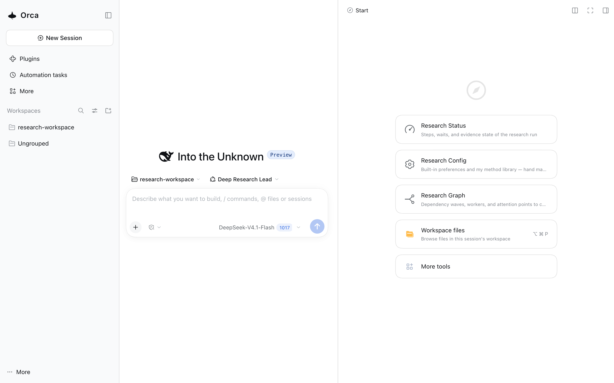
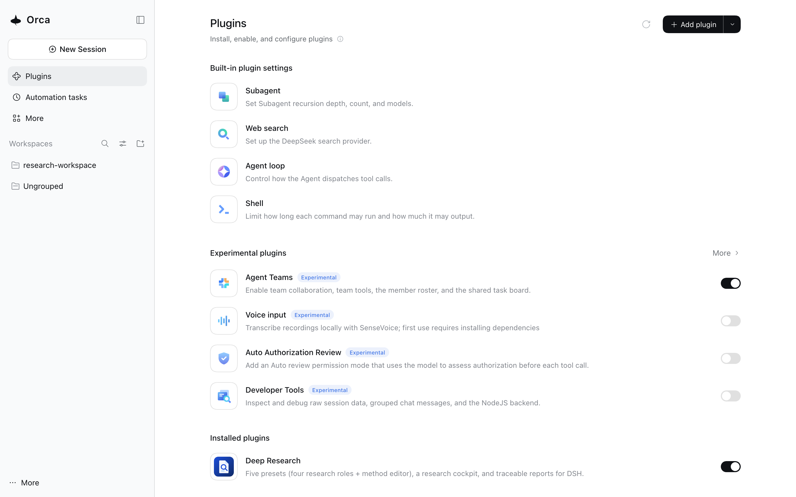

# Deep Research for DSH

把一个问题交给一支会互相核查的研究小队：Lead 拆题，Scout 找来源，Analyst 深读，Critic 挑错，交付一份每条关键结论都标了出处的报告。它装在 DeepSeek Harness（DSH）里；研究产物直接写进你选的项目文件夹。



## 你会得到什么

- **四个角色分工**：Lead 拆题与综合，Scout 找来源，Analyst 读材料，Critic 挑错；复杂题自动组队。
- **可核查的报告**：关键结论带 `[来源: evidence/xx.md]`；Critic 先查证据链，审阅不通过不交付。
- **看得见的进度**：右栏「研究状态」显示流程轨道、活动流与等你决定的挂起问题；交付后在「终稿」读读者版。
- **产物在你的项目里**：`drt_<slug>/`（问题、证据、报告、审阅）、`archive/`，以及跨 run 复用的方法库。

## 5 分钟装好

需要：已装好的 DSH（`dsh --version` 能打印版本，且落在 `0.2.1-rc.2` 到 `0.2.1-rc.5`）、Node `^22.19.0` 或 `>=24.0.0`、`pnpm`（团队能力要从 registry 取；离线需预装）。安装与首启不调用模型；跑研究才需要凭据（DeepSeek API key，或在 Web 界面里登录）。

```sh
# 1) 只做一次：建一个专用配置（DSH 里叫 profile——一份独立的插件配置，不动你现有的 DSH；已经有能用的 deep-research 配置就跳过，第一次装就照做）
#    注意：--from-default-profile 是替换，会删掉该配置原有的依赖与你加的配置
dsh --profile deep-research --from-default-profile web --dump-default-config

# 2) 装插件 + 团队能力（DSH 的可选 agent-team-profile；版本必须等于 dsh --version）
DSH_VER="$(dsh --version)"
dsh plugin --profile deep-research add file:/path/to/dsh-deep-research-pack-0.3.4.tgz
dsh plugin --profile deep-research add "@deepseek-ai/dsh-experimental-agent-team-profile@$DSH_VER"

# 3) 启动
dsh --profile deep-research
```

第 1 步只建配置，不装包。把 `/path/to/dsh-deep-research-pack-0.3.4.tgz` 换成你下载的安装包（发布页或交付目录里的 tgz，通常与手册同目录）。第二条 `dsh plugin` 命令装的是团队能力（`agent-team-profile`），不要用 `@latest`——它的 `latest` 不指向当前 DSH 版本线。npm / Plugins 页装包是发布后路径（当前 staged）；0.3.4 用上面的 tarball。

> 从源码交付（手里没有现成 tgz 时）：`git clone --recurse-submodules` → `pnpm install` →
> `bash dev/vendor-build.sh` → `node scripts/dist/export-dist.mjs`，再按手册装 `_dist/` 新生成的 tgz；
> 完整命令、profile 与团队层安装 = [CONTRIBUTING §From source to first run](CONTRIBUTING.md#from-source-to-first-run)。

装好的标志：Plugins 页 → **Installed plugins** 出现「深度研究 / Deep Research」（市场入口在 npm 发布后才出现）。打开一个会话后，右栏有「研究状态 / 研究配置 / 研究图谱」（终稿在交付后自动出现），主界面有「方法库」。更新插件后要重启 profile（Ctrl-C 停掉，再跑 `dsh --profile deep-research`）。



## 第一次研究

1. 打开终端里打印的 URL。它带 token，只在本机用，别截图或转发。
2. 第一次打开的界面会问你项目目录（有上次的工作区会直接落在那里，可在顶部切换）；选它，研究产物会写到它下面。
3. 直接说出你的研究问题，一句话到一段话都行。
4. Lead 先问三件事：研究类型、要多深、报告语言与时间范围；卡片里点选项即可（也能自由输入），选完看计划，确认后开跑。
5. 开跑后不用盯；要看进度就打开右栏「研究状态」。只有需要你补事实或审阅时才会来问。
6. 交付前 Lead 会带着证据与审阅建议来找你；先读「终稿」的读者版，再在交付卡里选「定稿」或给修改意见（审计版 `final/v<N>.md` 在确认后落）。

## 产物在哪

```text
<你的项目>/
  method-library.md        # 方法库：跨 run 复用
  drt_<slug>/              # 每场研究（slug = 题目短名）
    question.md topics.md plan.md
    evidence/              # 证据与出处
    findings.md review.md
    final/v1.md            # 审计版
    final/readable-v1.md   # 读者版
  archive/                 # 已交付归档
```

## 常见问题

- **一定要 API key 吗？** 装和首启不用；跑研究要，用账号登录或 `DEEPSEEK_API_KEY` 都行。
- **支持哪些平台？** macOS 已验证，Linux 预期可用；Windows 与完整 Desktop 路径未承诺。只支持 Web 界面。
- **会写我的项目以外的地方吗？** 研究产物只写你选的工作区；插件设置与会话/凭据在 `$DSH_HOME` 下（默认 `~/.dsh`，本插件的设置在它的 `deep-research/` 子目录）。
- **装或跑出问题？** 先看手册的「故障排查」一节；还不对，带上终端输出[开 issue](https://github.com/ethan-jiang-1/ai_dsh_deep_research/issues)。

## 更多

- 完整安装、升级、卸载、排障与安全：[_dist/安装手册.md](_dist/安装手册.md)
- 想改这个仓库：[CONTRIBUTING.md](CONTRIBUTING.md)；让 Agent 接手：[AGENTS.md](AGENTS.md)；调试先看 [probes/](probes/README.md)
- 设计、决策与方法论：[docs/00-index.md](docs/00-index.md)
- License: [MIT](LICENSE)
