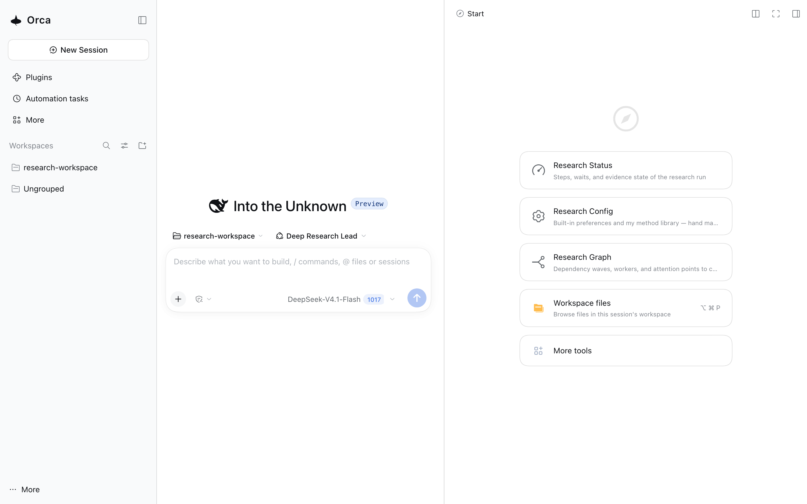

# 推敲：README 与安装手册改为使用者面向，开发面归位到既有入口

> 立卡：2026-11-07 ｜ 状态：已结 ｜ 类型：Task ｜ 结论倾向：现在做——已交付 ｜ 可关闭：是
> 结论：README 改为产品页（73 行）、手册在 D41 十一段内做用户路径优先、开发面归位 CONTRIBUTING；契约测试红先、冷读 3/5、`install-shape-smoke` 全绿。
> 去向：implemented — [Note](../../../notes/archived/2026-11-07-user-facing-readme.md)。
> 审查：语义自审通过（reviewing-a-delivery）；业务验收 = 用户（2026-11-07 授权落地）。

**问题与期望结果：** 用户 2026-11-07 反馈：根 `README.md` 与安装说明仍主要写给开发者/Agent 看，需要改为面向使用者；面向开发者的内容若必须保留，可另劈一个 MD。期望：**一个已经在用 DSH、没读过本仓任何文档的人**，只看 README 就能在五分钟内回答七个问题——这是什么、能给我什么、装之前要什么、第一条命令是什么、第一次研究怎么走、报告落在哪、坏了去哪。开发者与 Agent 的入口不消失，但不占产品页；能复用既有文件就不新开文件。

**当前情况：**

- 根 [README.md](../../../README.md) 49 行（预算 60）：首段即 `bundle` + `custom profile` + 五个 preset + D37/D40/D41；「用它」第一句是生成器与 owner（`scripts/dist/product-manual.md` → `_dist/安装手册.md`，勿手改）；「改它」「研发宪章」「Rules In One Screen」合计约 28 行（约 57%），是贡献者/门禁内容。
- 安装手册 [product-manual.md](../../../scripts/dist/product-manual.md)（生成 [_dist/安装手册.md](../../../_dist/安装手册.md)）258 行：§一 以「一个 DSH 插件包（bundle），不是一个独立应用」开头；§三 先要求选运行时（4 行表）与安装方式（4 行表）；§四 并列 A/B/C/D 四条路径，其中只有 C（离线 tarball）当前可走，且 C 在第四小节；§六 验证给的是 `--dump-config` 的 row id；§七 配置从 patch 层优先级讲起。
- 上一轮 [D38](../../../docs/decisions.md#d38)（2026-11-01）已把 README 从纯开发入口改成「用它 / 首屏 / 改它」，但「用它」仍是 owner 指针 + 内部术语，没有到产品页；[已结卡](2026-11-01-product-docs-and-dist.md) 的目标只完成了一半。
- 三个读者共用一页：使用者、贡献者、Agent。[CONTRIBUTING.md](../../../CONTRIBUTING.md)（121 行）已承载开发前置、验证与通道；[AGENTS.md](../../../AGENTS.md) 承载 Agent 入口；[docs/00-index.md](../../../docs/00-index.md) 承载文档地图——开发面有现成的家。
- 约束（改写时必须一起处理）：
  - [product-invariants](../../../tests/contracts/product-invariants.test.mjs) 断言根 README 出现 `_dist/安装手册.md`（安装入口指针不能丢）；
  - `dist-manual-fresh` 要求 `_dist/安装手册.md` 与 `scripts/dist/product-manual.md` 同步（只能改源再重导出，不能手改生成物）；
  - `doc-budgets` 给 README 的顶是 60 行（[doc-budgets.json](../../../scripts/doc-budgets.json)）；
  - `md-links` / `md-anchors` 覆盖 README 的所有链接与锚点；
  - [pack README](../../../packages/deep-research-pack/README.md)（303 行）与 `README.zh.md` 由 [readme-bilingual](../../../tests/pack/readme-bilingual.test.mjs) 锁同构，改一面要同时改两面。
- 面向使用者的「用户手册」已经存在（`_dist/安装手册.md` 随 tarball 交付）；问题是它的**主路径被参考内容淹没**，不是缺页。

**已拍板（2026-11-07，用户确认按推荐）：**

1. 语言：中文为主（根 README 与手册中文；英文/双语不在本轮）。
2. pack README：二期（npm 发布或下一轮再动；本轮不动 303 行双语同构面）。
3. 截图：2 张入库到 `docs/assets/`。
4. 开发面：复用 [CONTRIBUTING.md](../../../CONTRIBUTING.md)（不新开 `DEVELOPMENT.md`）。

**下一步：** 用户验收新 README/手册 → 写 `notes/archived/2026-11-07-user-facing-readme.md` 并归档（同变更）。本卡不授予实施授权（授权 = 2026-11-07 用户口头确认）。

## 外部依据：插件类项目的 README 与安装说明怎么写

### 权威指南

| 来源 | 结论 | 对本仓的落点 |
|---|---|---|
| [GitHub Docs · About READMEs](https://docs.github.com/en/repositories/managing-your-repositorys-settings-and-features/customizing-your-repository/about-readmes) | README 回答五件事：做什么、为什么有用、怎么开始、去哪求助、谁维护；只放「让开发者开始所需」的信息，长文档另放 | 根 README 只留产品页；机制与门禁进 CONTRIBUTING 与 docs |
| [npm Docs · About package README files](https://docs.npmjs.com/about-package-readme-files) | README 写安装、配置、使用，是包页面的正文 | pack README 二期同改 |
| [Standard Readme](https://github.com/RichardLitt/standard-readme/blob/main/spec.md) | 固定顺序：Title → Short Description（<120 字符）→ Install → Usage → 附加节 → API → Maintainers → Contributing → License（最后）；Install/Usage/Contributing/License 必填；描述要「渐进给出更多知识」 | 目标 TOC 直接采用这一顺序 |
| [Diátaxis](https://diataxis.fr/) · [地图](https://diataxis.fr/map/) · [tutorial vs how-to](https://diataxis.fr/tutorials-how-to/) | 四类文档：tutorial（单路径、消除意外）/ how-to（假设读者能干、为真实分支而生）/ reference / explanation | README = 短 tutorial + happy-path how-to；手册 = 分支 how-to；docs = reference/explanation |
| [Google 风格指南 · 步骤](https://developers.google.com/style/procedures) · [第二人称](https://developers.google.com/style/person) · [Microsoft · 分步说明](https://learn.microsoft.com/en-us/style-guide/procedures-instructions/writing-step-by-step-instructions) | 第二人称祈使句；一步一动作；位置先于动作；前置先于步骤；动作后给可观察结果；步骤放得下一页 | quickstart 与「装好的标志」的写法 |
| [Google 风格指南 · 行话](https://developers.google.com/style/jargon) | 行话要么绕开，要么首次出现时用一句人话解释 | 首屏术语禁令 |
| [Readme Driven Development](https://tom.preston-werner.com/2010/08/23/readme-driven-development.html) | README 是产品合同；一页讲不清的功能可能不属于用户故事 | 用 README 反推产品面是否收敛 |

### 样本（12 个真实 README，2026-11-07 抓取）

| 项目 | 生态 | README 形状 | 安装写法 | 开发文档 |
|---|---|---|---|---|
| [ESLint](https://github.com/eslint/eslint/blob/main/README.md) | npm CLI | 徽章 → 介绍 → ToC → 安装/用法 → 政策 | 2 条命令；Node 前置先写 | 官网 + CONTRIBUTING |
| [pnpm](https://github.com/pnpm/pnpm/blob/main/README.md) | npm CLI | 价值 bullet → 赞助 → 链接hub | 不放命令，链到安装页 | 官网 + CONTRIBUTING |
| [Changesets](https://github.com/changesets/changesets/blob/main/README.md) | npm CLI | 31 行短页：一句话 → 文档链接 → 徽章 | 无 | 独立文档站 |
| [Obsidian Tasks](https://github.com/obsidian-tasks-group/obsidian-tasks/blob/main/README.md) | Obsidian | 标题/一句话 → 截图 → 4 步安装 → 上手 | 4 个编号步骤 | 发布站 + CONTRIBUTING |
| [Tailwind IntelliSense](https://github.com/tailwindlabs/tailwindcss-intellisense/blob/master/packages/vscode-tailwindcss/README.md) | VS Code | 横幅 → 一句话 → 安装 → 功能 → 设置 → 排障 | 1 个市场链接 + 激活前置 | 仓库（无 CONTRIBUTING） |
| [vscode-eslint](https://github.com/microsoft/vscode-eslint/blob/main/README.md) | VS Code | 介绍 → 发布说明 → 设置参考（570 行） | 无扩展安装步骤 | 仓库（无 CONTRIBUTING） |
| [Dataview](https://github.com/blacksmithgu/obsidian-dataview/blob/master/README.md) | Obsidian | 一句话 → 截图示例 → 用法 → 贡献 | 无（社区商店） | 文档站 + README |
| [HACS](https://github.com/hacs/integration/blob/main/README.md) | Home Assistant | 32 行：是什么 → 亮点 → 链接hub | 无；完整手册在文档站 | 文档站 |
| [Refined GitHub](https://github.com/refined-github/refined-github/blob/main/readme.md) | 浏览器扩展 | 一句话 → 商店徽章 → 功能画廊 → 链接 | 每个浏览器一次点击 | wiki |
| [Dark Reader](https://github.com/darkreader/darkreader/blob/main/README.md) | 浏览器扩展 | 吉祥物 → 商店徽章 → 从源码构建 → 用法 | 每个商店一次点击 | CONTRIBUTING |
| [Cline](https://github.com/cline/cline/blob/main/README.md) | VS Code / CLI / 桌面 | logo → 一句话 → 各面安装 → 功能 | 每个面一条命令 | 文档站 + CONTRIBUTING |
| [Claude Code](https://github.com/anthropics/claude-code/blob/main/README.md) | Agent CLI | Node 徽章 → 一句话 → 演示 GIF → 2 步开始 → 插件 → 数据保留 | 2 步 + 平台变体 | 文档站 |

样本结论：

- **README 的安装保持短。** 12 个里只有 4 个（ESLint、Tasks、Cline、Claude Code）在 README 放多步安装；其余是一键、一条命令，或直接链到手册。
- **截图跟着品类走。** 功能画廊型产品放截图（Tasks、Tailwind、Refined GitHub）；纯 CLI 工具通常不放。
- **兼容性写在元数据与正文。** VS Code 扩展在 `engines.vscode` 声明且不允许 `*`（[官方 manifest](https://code.visualstudio.com/api/references/extension-manifest)）；Obsidian 插件在 `minAppVersion`（[Tasks manifest](https://github.com/obsidian-tasks-group/obsidian-tasks/blob/main/manifest.json)）；正文只给短矩阵。
- **开发文档离开产品页。** wiki、文档站、CONTRIBUTING，或独立用户指南——产品页只留一行。
- **反模式**（真实样本）：570 行 README 里 ~164 行设置、没有安装步骤（[vscode-eslint](https://github.com/microsoft/vscode-eslint/blob/main/README.md#typescript-and-javascript-settings)）；构建说明排在用法之前（[Dark Reader](https://github.com/darkreader/darkreader/blob/main/README.md)）；未定义的行话；不可验证的夸张词（[Google · excessive claims](https://developers.google.com/style/excessive-claims)）。

### 落成本仓的硬规则

1. 前 10 行 = 一句话（宿主 + 结果）+ 受众，不出现内部架构词。
2. 首屏给可复制的安装块，干净机器可跑。
3. 前置写在命令之前（宿主版本、Node、pnpm、凭据），不是命令之后。
4. quickstart 编号 1..N，一步一动作，动词开头。
5. 动作前说在哪做；动作后给可观察结果（「装好的标志」）。
6. 「你会得到什么」3–6 条结果 bullet，紧跟 quickstart。
7. 兼容矩阵短小，说明版本怎么检测；破坏性操作（重建 profile）就地警告。
8. 宿主需要重启这类操作注意，写在动作旁边。
9. 排障表 3–5 行：现象 → 原因 → 处置。
10. 升级、卸载、数据保留合为一节；安全一节（token/密钥/出网）。
11. 2–4 行「这不是什么」。
12. 开发者面只留一行链接（CONTRIBUTING / AGENTS）。

## 诊断：现在这一页在回答谁的问题

| 位置 | 现在写什么 | 用户读到什么 | 处置 |
|---|---|---|---|
| README 1–7 | bundle、custom profile、五个 preset、D 号 | 「这是内部工程」 | 换成结果一句话 + 4 条「你会得到」 |
| README 9–14 | 安装 owner、生成物、staged、doctor、guides/65 | 「先去读别的文档」 | 3 步 quickstart + 装好的标志 |
| README 16–20 | 首屏品牌与起步卡细节 | 还没装就看到界面细节 | 并入「第一次研究」走查 |
| README 22–49 | 改它、宪章、Rules | 贡献者手册 | 移到 CONTRIBUTING，README 留一行 |
| 手册 §一 | bundle ≠ 独立应用 | 定义先于用途 | 先讲「它给 DSH 加了什么」 |
| 手册 §三 / §四 | 运行时 × 方式两张表 + A/B/C/D | 四选一里三个不可用 | 唯一 happy path 前置；A/B/D 进附录 |
| 手册 §六 / §七 | `--dump-config` / patch 层 | 机制细节先于任务 | 用户可见验证优先；配置进附录 |

## 方案：三页分工，不新开文件

### 读者 → 页面 → 问题（单一 owner）

| 读者 | 页面 | 回答的问题 |
|---|---|---|
| 使用者（第一次） | README | 这是什么、值不值得装、怎么装、第一次怎么用 |
| 使用者（边界情况） | 安装手册（生成物） | 前置、完整路径、升级、卸载、排障、安全 |
| 贡献者 | CONTRIBUTING | 搭环境、跑验证、宪章与仓库规则 |
| Agent | AGENTS | 入口链、布局、纪律 |
| 想懂机制的人 | docs/00-index | 设计、决策、方法论 |

### 根 README 目标结构（约 90 行）

```text
# Deep Research for DSH
一句话（结果）+ 一句话（装在 DSH 里、产物写进你的项目）


## 你会得到什么
4 条结果 bullet（多角色分工 / 带出处的结论 / 研究状态与终稿 / 产物在项目里）

## 5 分钟装好
需要：DSH 0.2.1-rc.2–rc.5、Node 22.19+ 或 24+、pnpm；跑研究要模型凭据（安装时不需要）
1) 只做一次：建一个专用配置（DSH 叫 profile；已有 deep-research 就跳过；这条会替换已有配置）
2) 装插件与团队层
3) 启动
装好的标志：Plugins 页出现「深度研究 / Deep Research」；右栏四个研究页签；主界面「方法库」

## 第一次研究
1..6（选项目目录 → 问问题 → 三问 → 计划 → 等 → 审阅 → 终稿）

## 产物在哪
目录树（method-library.md / drt_<slug>/ / archive/）

## 常见问题
3 行（要 key 吗 / 支持哪些平台 / 会写我的项目吗）

## 更多
完整安装与使用手册 · 贡献（CONTRIBUTING）· Agent 入口（AGENTS）· License
```

### 安装手册目标结构（`scripts/dist/product-manual.md`）

```text
# Deep Research 安装与使用手册
表头元数据（版本 / 包 / sha256 / 兼容基线 / 平台）——保留六行，放在标题下，不占正文主路径

一、它是什么（结果导向；一句话解释「不是独立应用，是 DSH 的插件」）
二、开始之前（DSH 版本怎么查 / Node / pnpm / 凭据 / 平台表）
三、安装（唯一 happy path：三条命令 + 装好的三个标志 + 已有 profile 警告）
四、第一次研究（选目录 → 三问 → 计划 → 静默 → 审阅 → 终稿）
五、升级
六、卸载与数据保留
七、故障排查（按出现频率排）
八、安全与平台
附录 A 其他安装入口（Plugins 页 / npm CLI / 市场；staged 说明）
附录 B 高级配置（patch 层、settings.json、工作区优先级、--dump-config）
```

原则：主路径只留一条，其余全部降为附录；「验证」先用界面可见的变化，`--dump-config` 放附录。

### 开发面去向

| 现 README 内容 | 去向 |
|---|---|
| 「用它」的 owner/生成物/staged 细节 | 手册 §三 + 附录 A；README 只留 3 步 |
| 「首屏会看到」 | README「第一次研究」+ 手册 §四 |
| 「改它」 | [CONTRIBUTING.md](../../../CONTRIBUTING.md)（已含同内容）+ README 一行 |
| 「研发宪章」 | CONTRIBUTING `## 原则` |
| 「Rules In One Screen」 | CONTRIBUTING（仓库规则与门禁命令） |

**为什么不新开 `DEVELOPMENT.md`：** CONTRIBUTING 已承载开发前置、验证与通道（121 行，无预算上限）；AGENTS 承载 Agent 面；docs/00-index 承载地图。再开一个 = 第三个开发入口，违反「一个事实一个家」。触发新建的条件写在这里：CONTRIBUTING 超过约 180 行，或需要面向外部贡献者的架构讲解时，再拆 `docs/DEVELOPMENT.md`。

### 安装步骤的 owner（需要同 diff 改口径）

现状：README 与 [guides/65](../../../docs/guides/65-run-forms.md) 都写「安装步骤的唯一 owner = product-manual」。改成：**完整安装合同 = 手册；最短路径 = README**。防漂移 = 新增契约测试 `tests/contracts/readme-manual-commands.test.mjs`：README 代码块里的 `dsh` 命令必须逐字出现在 `scripts/dist/product-manual.md`（先看红再交付绿）。

### 输掉的方案

- **README 只做导航（现状加强版）**：用户仍要跳一次，GitHub 首屏仍是内部工程。
- **新建 `docs/user-guide.md` 让 README 指过去**：多一跳；首屏第一眼仍是开发页。
- **同轮全站双语**：维护翻倍，且当前没有英文读者证据。
- **只改文案不改结构**：§三/§四 的选择矩阵仍在第一条命令之前，结构问题不解决。

## 实施记录（2026-11-07）

- **README**：重写为产品页（73 行），预算 60→80（`_raises` 已登记）；开发面收成「更多」里一行路由。
- **手册**：保留 [D41](../../../docs/decisions.md#d41) 的十一段骨架（D 号变更需用户拍板，本轮不擅改）；用户路径优先落在内容上——§三 压成两张短表 + 「现在装 → §四 C」显式跳转，§四 开头即 profile 命令，§六 先给界面可见变化，§七 只留日常三项，patch 层/`--dump-config` 进附录 A。
- **开发面**：宪章与仓库规则进 [CONTRIBUTING.md](../../../CONTRIBUTING.md)；README 只留一行。
- **owner 口径**：[00-index](../../../docs/00-index.md) 与 [guides/65](../../../docs/guides/65-run-forms.md) 改为「完整合同 = 手册；最短路径 = README，命令由契约测试对账」。
- **契约测试**：新增 [readme-manual-commands](../../../tests/contracts/readme-manual-commands.test.mjs)，首跑红（README 0 条 `dsh` 命令，防空断言）→ 重写后绿；[run-driver-contract](../../../tests/run/run-driver-contract.test.mjs) 的开发入口断言随内容迁移到 CONTRIBUTING。
- **截图**：[首屏](../../../docs/assets/readme-first-screen.png)（含右栏研究状态/配置/图谱入口）+ [Plugins 页](../../../docs/assets/readme-plugins.png)（安装证据）；均在真实 3083 通道抓取，无 token。
- **冷读探针（2026-11-07）**：第一遍（72 行版）七问全对但评分 2/5；缺口 = tgz 来源、DSH 前置未点明、「已有 profile」无法自查、「重启」无命令、登录无指引、术语（时间口径语言 / slug / DSH_HOME / Web 面 / 首屏）。按缺口改完后第二遍评分 3/5、七问全对；剩余缺口 = tgz 分发地址、UI 操作细节（卡片怎么点）、DSH 先验知识——前两类归分发/手册，本轮不追。
- **验证**：`pnpm verify` 全绿；`pnpm test` 1045/1045；`install-shape-smoke` ALL PASS（profile → 两条 plugin add → 真启动出 token）；`readme-manual-commands` 首跑红 → 绿；`dist-manual-fresh` / `dist-manual-version` 绿。
- **未做**：pack README（二期，2026-11-07 拍板）；绑定态驾驶舱截图（需在飞 run）。

## 改动清单

| 文件 | 改动 |
|---|---|
| `README.md` | 按目标结构重写；开发面收成一行；预算 60 → 90（登记 `_raises` 理由） |
| `scripts/dist/product-manual.md` | 按目标结构重排；happy path 前置，A/B/D 与 patch 语义进附录 |
| `_dist/安装手册.md` | 由 `node scripts/dist/export-dist.mjs` 重导出，不手改 |
| `CONTRIBUTING.md` | 接收「改它」「研发宪章」「Rules In One Screen」 |
| `docs/guides/65-run-forms.md` | owner 口径改为「完整合同 = 手册；最短路径 = README」 |
| `tests/contracts/readme-manual-commands.test.mjs` | 新增：README 命令 ⊆ 手册命令 |
| `tests/contracts/product-invariants.test.mjs` | 保留 README → 手册指针断言；若链接形态变化同 diff 更新 |
| `docs/assets/readme-first-screen.png`、`readme-cockpit.png` | 新增截图（无 token），alt 文本 |
| `_backlog/issues/README.md` | 本卡登记进活跃清单 |

## 验收标准

1. **冷读者探针**：只给 README（不给 AGENTS/docs），一个无上下文读者回答七问全对，且没有把 staged 路径（Plugins 页、市场）当成当前可用路径；问答记录留档。
2. **首屏术语**：README 前 25 行的正文（代码块除外）不出现 `bundle`、`preset`、`roster`、`patch`、`launcher`、`HMR`、`pack`、`D18/D31/D38/D40/D41` 等内部词；`profile` 只允许作为命令参数出现，且同句给出人话（如「DSH 的命名配置」）。
3. **命令可跑**：README 的安装块在干净 home 可逐条执行（复用 `install-shape-smoke` 的序列或新增 doc-command 重放）；「已有 profile 不要重复第一步」的破坏性警告紧邻命令。
4. **手册主路径**：§三 只留运行时/方式短表并给出「现在装 → §四 C」；§四 开头即 profile 命令，C 段紧跟装包命令；A/B/D 保留（D41 十一段骨架），patch 层与机器核对进附录 A；`dist-manual-fresh` 与 `dist-manual-version` 绿。
5. **开发面归位**：README 的开发者内容只剩 1 行路由；宪章与 Rules 在 CONTRIBUTING 可读；AGENTS 入口链未被打散。
6. **机械门**：`pnpm verify` 与 `pnpm test` 全绿；README 预算升顶在 `scripts/doc-budgets.json` 的 `_raises` 登记理由；`md-links` / `md-anchors` 绿。
7. **信息不丢**：诊断表中的每一行现有内容都能在新结构里指到落点；`_dist/安装手册.md` 仍被 README 链接（product-invariants）。
8. **截图**：两张截图来自真实产品——首屏（含右栏研究入口）+ Plugins 安装证据；alt 文本在场，画面里无 token/密钥；文件放 `docs/assets/`。绑定态驾驶舱需在飞 run，本轮不拍。
9. **用户验收**：用户按 README 从零装一次（或明确认可可照做）。

## 已知风险

- **命令三处复制**（README / 手册 / pack README）会漂移 → 只让 README 放最短路径，加契约测试对账手册；pack README 二期再收束。
- **信息丢失**：删掉的每一句都要有落点（诊断表就是清单），否则开发者会找不到机制说明。
- **生成物**：手册只能改源再重导出；手改 `_dist` 会被 `dist-manual-fresh` 打回。
- **截图腐烂**：UI 改动后截图过期；只放 2 张、在 CONTRIBUTING 记「UI 大改时重拍」，不追求每次同步。
- **双语**：若选双语，pack README 的 `readme-bilingual` 同构约束会扩大到根 README，维护成本先算清。
- **语言混搭**：CONTRIBUTING 目前是英文；把中文段落搬过去时需要翻译或双语化，跟语言决策一并定，不能直接粘。

## 关闭条件

- 验收 1–8 全绿，用户验收（第 9 条）完成；交付时按 [issue-to-note](../../methods/issue-to-note.md) 选去向（拟 `implemented`），Note 与归档同变更。
