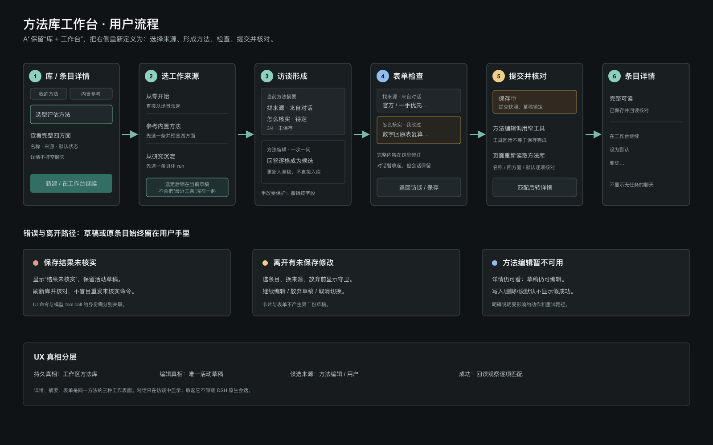
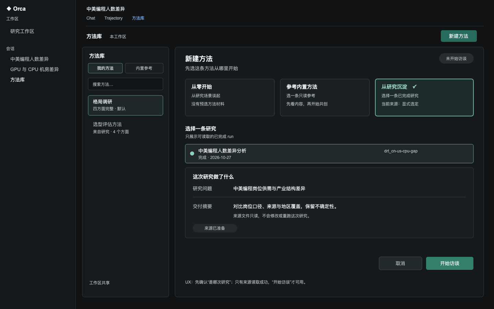
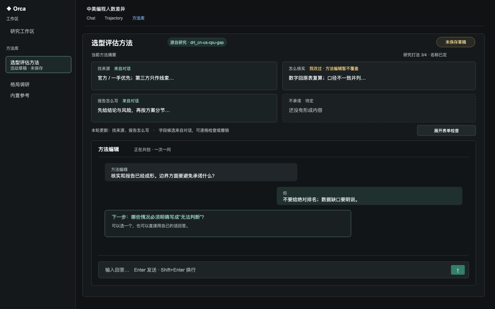
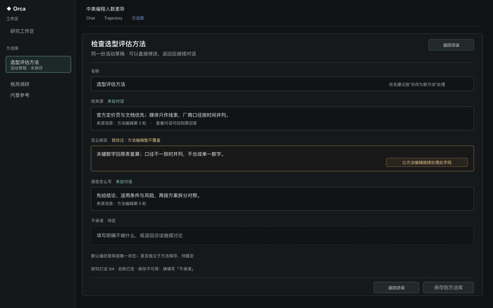
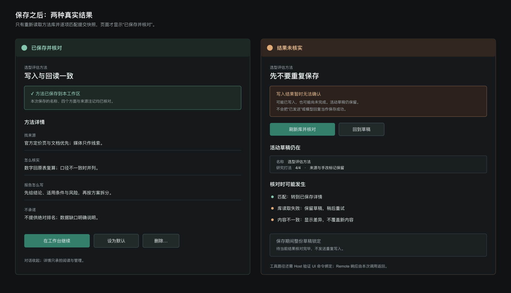

# 方法库工作台：对原 A 方案的独立重审

> 这是一份设计重审，不是对原 A 方案的机械补充，也不是实现计划。原稿把“库 + 工作台”的大方向定得很接近答案，但把过多产品语义压在“草稿卡 + 对话”这个视觉形状里。本页重新从用户任务推导工作台的结构、状态和承诺。

## 结论

用户已采纳本 A′ 作为原 A 的精化方向：保留两列和摘要/对话上下关系，按本页定义的详情、访谈、表单检查与数据状态合同继续实施。普通保存不切换默认；编辑保留目标条目的默认状态；另存为保留旧条目并不改变默认；单独设默认切换唯一标记；删除默认后允许零默认。UI 另提供「保存并设为默认」与独立「清除默认」。保留模型可见 Host tool 写入；Client Remote 直接写入不授权。当前实现已接入 Host projection 与 Client callId 回读；真实 Loader 组合与 client-load 页面装配/交互 smoke 已通过，用户业务验收仍未完成；issue 保持活跃。

保留 A 的**宏观空间判断**：左侧管理方法库，右侧承载当前工作；页面保持两列，不跳出“方法库”页。

重新定义 A 的**工作台内部**：上部不再被理解成一个需要和表单同步的“草稿卡”，而是一个紧凑的**当前方法摘要区**；下部才是方法编辑的主要工作区。摘要区只负责让用户始终知道“正在形成哪条方法、四个方面到哪一步、哪些来自对话、哪些是我改的”，不承担完整编辑。

工作台的主流程不是“表单和聊天同时存在”，而是：

```text
选择工作来源 → 方法编辑一次一问 → 摘要区逐格长出 → 用户检查/完善 → 保存 → 回读核对
```

这会保留 A 解决的拥挤问题，同时避免把页面误导成一个“聊天框旁边放一张表单”。用户管理的是一条工作区方法；对话、摘要、全表单都是这条方法在不同阶段的工作视图。

## 1. 原稿中应保留的判断

### 1.1 库与工作台必须分开

左侧库解决“我有哪些可复用方法、当前选中哪一条”；右侧工作台解决“我正在形成或修订哪一条”。这是两个不同任务，不能重新合并成一个窄侧栏。

左侧库在工作台活动时保持稳定，不随对话回填跳动。用户可以看到当前条目的位置、内置参考与自己的方法，但切换条目必须经过未保存守卫。

### 1.2 对话必须是正常的聊天

方法编辑不是一个附加提示框。它需要保留历史、问卡、输入、停止和失败状态；用户上翻阅读时不被新消息强行拉回底部。聊天滚动继续使用 DSH 原生会话滚动容器，工作台不能再包一层会争抢滚动权的聊天滚动器。

### 1.3 草稿、表单、保存封套必须只有一个真值

已保存方法的权威内容是工作区 `method-library.md`；编辑中的真值是唯一活动草稿；方法编辑消息是候选输入；保存命令引用一次不可变提交快照；Host 报告写入结果，且 Client 在一次回读观察中逐字段看到目标态符合快照，才向用户报告“已保存并核对”。这表示该次观察时读到的目标态一致，不证明它由该命令唯一造成，也不证明读取后不会再被改写。方法文件与 Client 的回读证据不是一个跨资源原子提交。

因此，摘要区与全表单不能各自持有状态，也不能通过文本重新互相解析。它们必须读取同一份活动草稿并调用同一组字段更新函数。

### 1.4 方法编辑不替用户做最终决定

方法编辑负责把口语整理为四个可执行方面，不负责替用户选择方法边界，也不应该在没有来源上下文时猜测“这次研究”指什么。任何从内置参考或 run 沉淀的路径都必须先选定具体来源。

## 2. 原稿中需要推翻或降级的判断

### 2.1 “草稿卡”不是一个领域对象

原稿把草稿卡放在工作台上半部是有空间理由的，但“卡”这个词容易把它设计成一个独立编辑对象。它实际上只是活动草稿的摘要投影。建议产品文案使用“当前方法”或“方法摘要”，代码层可以保留 `DraftSummary`，但不要让卡和表单拥有不同的状态模型。

摘要区只展示：名称、来源、四个方面的短摘要、完成度、未保存状态、保存动作。长内容截断；字段点击进入全表单并聚焦该字段。摘要区不提供第二套字段编辑控件。

### 2.2 不要在首次进入时同时展示三个模糊的起手按钮

“从零聊 / 照内置改 / 从这次研究沉淀”不是普通聊天快捷回复，而是三种不同的建稿来源。把它们混成对话中的三个胶囊，会让用户不知道点击后是否已经开始对话、来源是否可更换、run 到底是哪一次。

重新定义为工作台的**开始状态**：

- 从零开始：直接进入访谈；
- 参考内置方法：先选一条内置参考并预览四个方面，再进入访谈；
- 从研究沉淀：先选择一条具体 run，看到问题与交付物摘要，再进入访谈。

来源选定后显示在摘要区并锁定到当前活动草稿。要换来源，走“重新开始”并经过放弃当前修改确认。

### 2.3 不把读态设计成一个缩小版工作台

已保存条目的主要任务是阅读和管理，不是持续占着一个空的聊天区。读态应是条目详情：四个方面完整可读，来源和默认状态清楚，提供“在工作台继续”“设为默认”“删除”。对话默认不挂载、不占高度；“在工作台继续”才创建或恢复该条目的活动草稿并显示摘要区与对话。

这也避免“和编辑聊聊”与“编辑”两个近义入口产生不同语义。读态只有一个进入工作台的主入口。

### 2.4 不把“刷新恢复”当成已有能力

DSH 会话历史不自动等于活动草稿：用户的手改、字段保护、基线和保存操作状态不都在 Session log 中。当前标准 base composition 挂载 DSH JSONL provider；该 provider 对每个 append batch 在 append 解析前 fsync，但这不使任意 `Session.append()`、其它 persistence provider 或业务文件写入自动具备同一耐久语义。`sessions.flush(session)` 等待已注册的 durability listeners；它不提交方法文件或 UI draft。当前方法库视图把 draft、手改集合与来源状态保存在 React `useState`，随组件生命周期存在；Session history 可恢复并不意味着这些字段会恢复。pack README 另约束不写浏览器存储，FAQ 原件缺席不能放宽该约束。没有经批准且已接入的结构化 checkpoint 时，不承诺完整 draft 刷新恢复。

正确的设计承诺应分层：

- **页面内模式切换**：同一活动草稿必须保留；收起对话不能卸载会话树；
- **会话历史恢复**：方法编辑的历史可以恢复，但只凭历史文本不能静默重建完整草稿；
- **完整草稿恢复**：只有存在带 `draftId`、revision、字段来源和手改锁的结构化 checkpoint 时才承诺；没有 checkpoint 时，在离开/刷新前明确提示未保存草稿可能丢失。

如果最终要提供刷新恢复，checkpoint 必须成为单独的设计与验证项，而不是把“确定性 session id”当作恢复协议。

### 2.5 “不改窄工具语义”不能掩盖写入合同缺口

当前 `method_library_upsert` 按名称写入，不能表达原子改名，也没有 pack 业务操作身份或基线 revision。DSH 的 prompt `requestId` 关联 UI 提交到方法编辑 Session 的 inbox 用户消息；tool `callId` 关联模型之后那次 tool/call 与 tool/result；Connection 的 transport `rpcId` 则关联一次 Remote 请求/响应。三者作用域不同，prompt `requestId` 不会自动成为之后 tool call 的身份。产品和架构选择仍未裁定。延续现有模型可见工具路径，除定义 pack `operationId` 并把它放进冻结快照、prompt envelope、工具参数和 Host 结果外，还须由 Host 证明该工具调用所带 id 对应一条有效的待处理 UI 操作；仅让模型回显 prompt 中的字符串不能建立可信关联。DSH 的 `callId` 只关联模型 tool call/result；标准 event flow 没有把它自动绑定到发起 prompt 的 `requestId`。该 Host 关联协议、模型遗漏或改写 id、迟到结果和多工具调用处理都未实现，且 id 回显本身不提供重试幂等。另一方案是让 UI 通过 Host Remote 直接命令共享业务 owner；DSH Remote 的 `rpcId` 足以关联该次请求/响应，不需要另造 id 来做一次性响应相关性，但不提供超时后的幂等或持久恢复。此方案会改变当前 pane 不直写、写入须经模型工具的 D25 产品决定，须独立评审。`api-remotes` Client facade 只挂载其固定的构建时清单，并不自动包含 pack Remote；pinned DSH 也允许 Client 插件导入生成 contribution 并调用 `ctx.remote.$mount()`，故自挂载是一个需验证的应用装配路径，不能预先断定必须改 facade。无论选哪条路径，都须验证 Host/Client 产物接线、可信 Session/workspace 授权与生命周期。两者都不是当前已接入能力，须先裁定产品政策和装配范围。名称编辑仍须是另存为新方法，否则会留下旧条目。

并发能力需要说得更精确：pinned DSH Host `ctx.fs` 有原子发布和可选 `replaceIfVersion`。base-backed profile 挂载 `fs-sandbox`；Host pack plugin 还须显式注入 `fs` 并声明 `@deepseek-ai/dsh-fs` 类型/依赖，当前 pack Host 入口尚未这样接线。Pack 操作还须从 owning Session 派生 cwd 与 sandbox policy；`ctx.fs` 不会自动继承当前 agent 的 policy。写前版本来自独立 metadata/read 调用，不是与内容原子配对的快照。一个 provider 实例内的 per-target lock 能串行化该实例自己的 probe 至发布；不同实例/进程没有共同锁，替换 guard 只在 staging 前检查，外部写者仍可在检查后抢先发布并被覆盖。故它能提供原子可见发布及有限 stale rejection，不是跨进程 CAS。实现细节与逐项来源见本工作区材料 `2026-10-29-method-library-dsh-data-contract.md`。

原稿的“不改窄工具语义”只能作为当前交付范围的假设，不能当成 UX 设计的永恒边界。后续仍须明确哪些写者受支持、冲突如何呈现，以及是否允许工作区外部写者；“单写者”文案本身不能约束手工编辑或另一个 DSH 进程。

### 2.6 DSH 提供存储机制，但当前 pack 政策不允许据此直接落盘

pinned DSH base composition 有 `storage-domain` 并路由到 `storage-json`。Pack 可定义 schema 后持久化 Host-side 非 session records；同一 domain 的更新串行，持久化确认后才更新内存并通知。但它不是预配置的草稿库：workspace identity/key、数据保留/清理、schema 演进、Client Remote 和恢复协议均由 pack 负责。一个 domain 在 Host 中静态声明、同名只允许打开一次，workspace 应是 record key 而不是动态 domain 名。JSON backend 是当前 base 路由且无跨进程写锁；SQLite 可由部署显式选择，但不会让 domain record 与 workspace 文件、Session log 成为同一事务。

DSH 还提供 Host `ctx.fs` 文件服务。base-backed profile 挂载 `fs-sandbox`；独立 `sdk-minimal` 不叠 base，而挂载 `fs-local`。当前 pack Host 入口 `inject=[]`，故尚不能访问 `ctx.fs`；若选此路径，须声明 `inject: ['fs']` 并将 `@deepseek-ai/dsh-fs` 加入 pack 的 `peerDependencies` 与 Host 类型解析依赖。Host runner 只暴露插件在 `inject` 声明的服务。Host owner 必须从 owning agent Session 派生 cwd 与 `sandboxPolicy.resolve({ session })` 结果，显式传给 mutation；省略 policy 会退回部署默认值。`readText` 与 `stat` 是独立调用，不能组成内容与版本 token 原子对应的快照。`replaceIfVersion` 只在写操作起始 probe 时检查；同一 provider 实例的 per-target lock 覆盖至发布，不同实例/进程无共同锁，外部 writer 能在检查后、原子发布前介入。它提供原子可见发布和受限 stale rejection；`fs-local` 会 fsync 暂存文件，但没有证明 parent-directory fsync，故不承诺断电后目录项的 durability。`fs-sandbox` 的 mutation fence 不限制 read/list；`workspaceFiles` 对文件拒绝最终路径为 symlink 的读取，但允许工作区外文件路径，且文件读取不受 workspace root containment 约束。Host owner 仍须为方法库读写定义路径与 symlink 策略。该机制不是跨进程 CAS，也不是跨 `storage-domain`、文件与 Session log 的事务。

deep-research-pack 当前 README 声明“插件代码对 `$DSH_HOME` 零写入”，并明确“不写浏览器存储”。当前方法库把 draft 与手改状态放在 `MethodLibraryView` 的 React `useState`；它只在该组件挂载期间存在。A′ 的对话、摘要和表单若拆成多个组件，应由一个主组件/controller 持有同一份 draft；若需要跨 registration/remount 共享，可使用 DSH entry-declared store 承载暂态 viewing/interaction draft，但不得启用 localStorage 或把 store 当 durable business record。刷新、卸载或重建后不保证恢复。若产品要求跨刷新恢复，须先裁定 draft-data policy 并选择 owner：workspace checkpoint 会新增 workspace 文件，须明确批准其内容、版本、清理和误提交风险；Host `storage-domain` 会改变零 `$DSH_HOME` 写入政策；browser-local persistence 违反当前零浏览器存储政策。FAQ 原件不在当前 checkout；仓内归档摘要只把 FAQ 禁止项表述为不得将 session-derived facts 存入 localStorage，不能用它覆盖 pack 当前更严格的政策。

`ctx.fs` 是 Host 服务；Client 的 `workspaceFiles` 仍然只读。若经 Client Remote 提供业务写操作，pack 须提供 Host owner 和生成 contribution，并由 pack Client 插件自行挂载或由应用 facade 显式组装；agent tool 与 UI 应调用同一业务逻辑。持久 draft 还需定义稳定 workspace identity/key、schema 演进、孤儿 checkpoint 清理、pending operation 恢复与来源数据生命周期。

Session log 适合保存访谈与模型可见操作记录，不等于草稿数据库。`session/flush` 只等待 session 持久化 listener 落盘；它不提交工作区文件。pinned DSH 的 `appendPluginRecord` 被限制给 experimental package，不能把它当作此 pack 隐藏存草稿的生产捷径。普通 session 事件可扩展，但会进入正式事件格式与兼容责任；草稿字段、手改锁和保存状态应由业务状态 owner 明确保存。

`workspaceFiles.read/stat/changes` 可以读取完整文件分页、报告观察到的 file version，并监听失效通知；该服务没有写操作。version 是观察值，不是 expected-version 写前置条件；读取结果也可能在 stat 后被并发写改变。它能帮助发现冲突，不能独立阻止冲突。

因此，DSH 提供了实现 A′ 持久恢复和较强 Host 写入所需的底层机制，但当前 pack 尚未接入这些机制或定义业务协议。它们不能直接推出跨进程共享写安全。Pinned 源码证据与 API 引用集中在同目录的 DSH 数据合同材料中。

## 3. 重构后的工作台形状：A′

### 3.1 三个表面，而不是三栏

页面仍是两列，但右侧工作台有三种表面状态：

1. **条目详情**：阅读已保存条目，管理默认和删除；
2. **访谈工作台**：摘要区 + 方法编辑对话，主任务是形成方法；
3. **表单检查**：完整字段编辑与检查，主任务是修订内容；对话暂时收起，返回后恢复历史和滚动位置。

“详情 / 访谈 / 表单”是互斥的工作表面；它们共享活动草稿或已保存条目，但不同时提供多套编辑控件。

### 3.2 访谈工作台

右侧从上到下：

- **工作台头部**：当前方法名称、来源、`未保存`/`正在保存`/`需要复核`等状态、主要动作；
- **方法摘要区**：四个方面的紧凑摘要，名称和完成度；字段有“待定 / 来自对话 / 我改过”来源标记；
- **方法编辑对话**：完整历史、问卡、输入、停止/重试、自动贴底与上翻暂停。

摘要区不承担完整文本编辑。长字段不在收起状态强行塞进固定卡高；点击字段进入表单检查，焦点落在该字段。这样“卡不滚”仍成立，但不会让用户误以为截断内容就是完整编辑面。

摘要区的操作保持稳定：

- “展开表单”进入表单检查；
- “保存”提交当前冻结快照；
- “放弃当前草稿”明确丢弃活动事务；
- 对话中的回填只更新摘要和草稿，不直接改变库。

### 3.3 表单检查

表单检查不是第二个编辑器，而是同一草稿的高密度检查面：

- 四个方面都必须有 trim 后的非空值，名称也必须非空，才允许保存；Host `upsertMethodEntry` 对四字段采用 trim/非空守卫；
- 缺项时禁用主要保存动作并指出缺失字段，不能只等点击后才显示错误；
- 字段按四个方法方面呈现，使用与保存相同的 trim/空值规则；
- 当前字段可以直接编辑；
- 手改字段显示“我改过，方法编辑暂不覆盖”；
- 可选择“让方法编辑继续处理”，但只解除后续回填保护，不立即覆盖当前值；
- 返回访谈工作台时不重复保存，不重建会话，不清空滚动位置；
- Markdown 预览属于次级检查，不放在主操作路径上。

### 3.4 详情表面

已保存条目详情应优先展示完整内容，不再展示一个没有任务的空聊天区域。操作语义：

- **在工作台继续**：以该条目为基线创建活动草稿；
- **默认操作**：普通保存/编辑/另存为不隐式切换；设默认、保存并设为默认、独立清除默认均为显式动作；写入后回读确认。零默认合法，删除默认不自动提升；
- **删除**：二次确认，写入后回读确认条目已不存在；
- **内置参考**：只读详情，操作为“用这条参考开始新方法”，不会修改内置条目。

设默认、清除默认与删除由当前 Method Editor Session 中的显式操作命令发起，不依据 assistant prose 结算。Host 投影只接纳 owning `user-rpc` 消息中的命令标记，并将一次 operation claim 绑定到 tool name、动作、名称、payload hash 与 `callId`；工具验证 owning Session 与 workspace `cwd`，回读真实文件后写 `presentationMeta`。Client 只在匹配 tool result 后独立读取完整文件并核对预期状态。Remote 直写路径没有授权。

## 4. 从入口到完成的用户流程

### 4.1 从零开始

1. 点“新建方法”；
2. 工作台显示开始状态，用户选择“从零开始”；
3. 方法编辑先问研究场景；
4. 每轮回答形成一个或多个字段候选，摘要区显示本轮变更；
5. 四个方面齐全后，方法编辑引导用户检查名称与边界；
6. 用户可以进入表单检查，也可以直接保存；
7. 保存只在写入、回读和完整核对成功后进入详情。

### 4.2 从内置参考开始

1. 用户点“参考内置方法”；
2. 选择具体内置条目并查看四个方面；
3. 点“以此为基础开始”；
4. 访谈上下文明确标记参考条目；
5. 新条目必须有自己的名称，不把内置条目当成用户条目覆盖。

### 4.3 从 run 沉淀

1. 用户点“从研究沉淀”；
2. 工作台列出可读的已完成 run；
3. 用户选择一条，看到 run 名称、研究问题和交付物摘要；
4. 只有来源读取成功后才允许开始访谈；
5. 方法编辑只读该 run 的规定文件，不重跑研究；
6. 保存后的来源注记指向所选 run，而不是模糊的“最近研究”。

### 4.4 继续修订已保存方法

1. 详情页点“在工作台继续”；
2. 活动草稿带入已保存内容与来源基线；默认标记作为基线观察值展示，不属于普通内容保存字段；切换默认使用独立显式操作；
3. 对话明确显示“正在修订：名称”；
4. 用户对话回填或进入表单检查；
5. 只有当前活动草稿保存并核对成功后，才替换原条目。

### 4.5 改名与重复名称

已有条目改名不走隐式原地更新。用户改动名称后，主要动作变为“另存为新方法”：

- 原条目保持不动；
- 新名称必须经过撞名确认；
- 新条目保存成功后，用户可回到详情决定是否删除旧条目；
- 不允许一次操作既改名又静默删除旧条目。

现有 Markdown fold 保留重名条目，Host upsert/remove 则只命中首个匹配标题；名称相同不保证是唯一记录。因此开始编辑、删除、设默认或核对之前，若目标名称出现多次，必须先拒绝该操作并提供修复/选择流程；另一个长期选项是引入稳定 entry id 并迁移格式。仅加新建时撞名确认不能消除已有库的歧义。当前来源证据见 `packages/deep-research-pack/src/lib/library-fold.ts:39-48` 与 `packages/deep-research-pack/src/lib/method-library-write.ts:47-58,80-92`。

这在 UI 语义上把破坏性操作交给用户，但当前工具只收到新条目并执行 upsert，无法确认新建与撞名，也不会原子地传达旧名称。保存回读必须确认新条目已形成；旧条目是否保持原样要明确写进 `save-as` 操作结果。

## 5. 状态模型：四层分开

### 5.1 权威数据与读取观察

- 用户方法条目的权威内容是工作区 `method-library.md`：条目名称、四个方面、来源注记、默认标记和旧格式正文；
- Client 对该文件的已读/缺席/失败状态是带读取时刻的观察，不是持久领域字段；`workspaceFiles` 返回的 version 也是 freshness 观察，不能与分页正文组成事务快照；
- 内置参考由 pack 提供且只读；研究 run 由用户选中的 workspace 文件提供且只读。

### 5.2 活动草稿与操作状态

活动草稿是页面内唯一编辑真值，不是当前 pack 已批准的持久业务数据记录。A′ 应由方法库主组件/controller 或一个未启用持久化的 DSH entry store 持有一份结构化暂态 draft，对话、摘要、表单只是它的投影；不要把 fields 复制到多个局部状态与消息解析结果中。若 draft 是业务已保存记录，权威数据仍只能来自 workspace `method-library.md`。

- `draftId`，仅用于当前页面活动草稿的稳定关联，不等同持久记录 id；
- 新建或修订目标；
- 加载时的基线条目及当时观察到的库正文/version；DSH `workspaceFiles` 不能将它们作为事务快照返回，当前 Host tool 也不接收该观察值作为 write precondition；
- 当前名称和四个方面；原条目的默认标记作为库元数据保留在编辑基线，普通内容保存不变更它。切换默认由独立操作表达；可以另提供明确的“保存并设为默认”组合动作，但必须显示其全库副作用；
- 每个字段的来源：待定、来自对话、用户修改；
- 用户保护字段集合；
- 来源上下文；
- 当前草稿 revision 与 dirty 判定。

`4/4` 只由四个方面的规范化非空值计算；名称另行显示“名称待定/名称已定”。名称及四个字段都须 trim 后非空才可保存。字段完整度与名称状态必须分开显示。当前 Host `upsertMethodEntry` 拒绝空名称和任一 trim 后空白字段；空项时 UI 应在提交前阻止保存并指出字段。

### 5.3 对话与操作状态

Method Editor Session 承载访谈历史；它不是草稿或业务操作结果的权威 owner。读态默认不挂载 Coach 面板；访谈/表单或显式操作需要时才 ensure 并 retain。操作提交等待 `remote.session.follow` 的 opening history 以确认 watcher 已经订阅，然后再 queue；历史帧只建立 ready，不回填旧草稿。DSH reference.ready 只说明初始 open 尝试 settle，不保证成功；当前 pack 在面板创建后 await ready、检查 snapshot 的 `openState` 必须为 `open`，再以 follow 的 opening snapshot 作为操作监听就绪条件；未持久化草稿、pending 操作或恢复协议。当前 pack 为每个组件生命周期内的活动 draft/action 生成随机 draftKey，并据此创建独立 Method Editor Session；该 key 不持久化，重挂载或刷新不会恢复原 Session。workspace `cwd`/workspaceId 仍由当前主会话派生；Host 写入工具只依 owning Coach Session 的 cwd 定位文件。跨进程历史持久性取决于 provider；Session persistence 不提交方法文件。

- 访谈空闲、思考、等待用户、停止、失败；
- 保存已提交、工具处理中、工具已回话、回读核对中、已核对、结果未核实、失败；
- 删除已提交、删除中、已确认删除、删除结果未核实、失败。

当前采用模型工具写入路径。页面为每次保存/删除/默认操作生成 pack `operationId`，保存操作还携带完整 entry 的 SHA-256 摘要；owner prompt 的 durable `user/message.source.rpcId` 只与对应命令正文配对，不与 tool `callId` 混作身份。Host projection 只在 Method Editor owning Session 中接纳命令，并将 claim 绑定动作、目标名、摘要、turn 与单次 tool `callId`；Host tool 重算保存摘要，按 Session `cwd` 写盘、重新读取并核对内容和默认列表，随后通过 `presentationMeta` 返回结构化结果。Client 只在观测到匹配 operationId 的 tool call/result 后读取完整分页文件并比较该操作要求的整个库状态；自然语言回执不结算结果。请求拒绝可明确失败，传输异常/超时或目标态无法核对显示 unknown；不自动重发、不承诺跨刷新 operation journal、跨进程 CAS 或 exactly-once。完整 Loader/tool/workspace 文件行为由 `scripts/smoke/method-library-tool-smoke.mjs` 证明；页面点击和视觉仍由真实浏览器及用户验收。保存核对包括名称、来源注记、四个方面、旧正文与默认列表；其他 UI-only 来源上下文不描述成已持久化字段。

### 5.4 UI 投影状态

- 详情 / 访谈工作台 / 表单检查；
- 左库宽度、窄屏是否折叠；
- 对话是否展开、滚动位置、是否在底部；
- 当前 active 字段、焦点和高亮；
- 进度、来源标、未保存提醒。

这些不是方法条目的领域属性，不应写进 `method-library.md`，也不能成为卡片与表单的第二份真值。

### 5.5 数据 owner 与恢复选项

当前 pack 的数据政策禁止 pack-owned browser persistence 与 `$DSH_HOME` 写入。以下 owner 表记录当前实现和允许承诺的范围；未来的 durable owner 都需先取得对应政策决定。FAQ 26 的一般归档摘要只把 localStorage 禁止项限定在 session-derived facts，并不能推翻 pack 更严格的现行规则。

| 数据 | Owner / 当前事实来源 | 不承担的职责 |
|---|---|---|
| 已保存的方法条目 | 工作区 `method-library.md`，在迁移决定前保持现有格式 | 不记录未保存字段保护状态或 UI 展示状态 |
| 工作区读取状态 | 当前 Client `MethodLibraryView` 通过注入的 `workspaceFiles` 读取 | 只读观察面；不能提交或原子核对版本 |
| 已保存方法的目标态 | 工作区 `method-library.md`；Host 工具写入，Client 回读只作核对证据 | 当前 Host 与 Client 写/读不构成事务；回读错误不能折算为空库 |
| 活动草稿（当前） | `MethodLibraryView` 组件的 Client `useState`；A′ 可将暂态 draft 提升到单一 owner 或未持久化的 DSH entry store | 当前组件重建/卸载即丢；entry store 也不等于 durable checkpoint |
| 当前命令等待/回执相关页面状态 | `MethodLibraryView` 的 `useState` / `useRef` | 仅当前挂载实例内关联；不是持久操作账本，刷新/卸载后不能续接原命令 |
| 访谈历史 | 当前 Method Editor DSH Session log（workspace 级复用） | 不保证一 draft 一 session；不从历史文本猜当前手改锁、dirty 状态或保存结果 |
| 用户当前看到的表面、焦点、滚动位置 | Client 页面状态 | 不作为领域数据或持久恢复依据 |
| 保存操作证据 | 候选 Host 命令的结构化结果 + Client 库回读观察；当前页面状态只在挂载期间关联 | 不是持久操作账本；自然语言回执不单独构成成功，也不证明读回目标态由该命令造成 |

若以后批准刷新恢复，一个候选最小模型是同一 workspace 至多一份活动草稿；每次“新建/重新开始”产生新 `draftId`，确认废弃旧草稿后才切换。记录须能重建 schema 版本、稳定且获政策认可的 workspace identity、草稿 revision、基线库正文及可用版本线索、目标条目快照、来源引用、字段值/来源/手改保护、coach `sessionId`、待处理 `operationId`、冻结快照和操作阶段。`workspaceId` 不是天然永久键；须考虑 workspace 删除重建、路径迁移及孤儿记录。方法库既有清理纪律禁止 scaffold 自动删除 `method-library.md` 等用户数据；新增的可清 checkpoint 也必须单独界定授权、删除主体与恢复失败处理，不能沿用通用 orphan cleanup 名义静默删除。checkpoint 即使放在 workspace 文件中，也不能与 `method-library.md` replacement 原子提交；须定义两文件不一致时的恢复规则。

若实现跨刷新 checkpoint，仍需在两个会话方案中作出选择：每个 `draftId` 使用独立 coach Session，或复用 workspace Session 并为每条候选增加 `draftId` 与基于的 draft revision。当前为每个组件生命周期内活动 draft 创建独立 Method Editor Session，操作型按钮在详情态也使用独立 action key；切换来源先确认放弃现有草稿，再创建新 draftKey。不同 draft 的 watcher/历史隔离，旧 Session event 不回填新 draft。draftKey 与草稿都不跨 view teardown/刷新保存。操作提交会等 `session.follow` 的 opening history 后才发送；面板创建后另行 await `SessionReference.ready` 并检查 snapshot `openState`，两者分别承担历史可读与操作订阅就绪。

访谈输出应成为带 draft 身份、基线 revision、字段 patch 和建议来源的结构化操作，再由 Host owner 校验并合并。`assistant/message` 中的 markdown fence 没有稳定的 draft 身份或字段 provenance；扫描最后一条文本、用用户消息正文或名称匹配回执都会留下迟到消息串入新稿的路径。

写入协议至少要区分新建、更新、另存为、设默认和删除的目标语义，并携带操作身份、基线、冻结目标与结构化结果。Host 是业务校验、路径授权和共享串行化的合适 owner；UI Remote 与 agent tool 应调用同一业务逻辑，但工具执行身份与 UI command 身份仍分开。`api-remotes` facade 不自动挂载 pack 自有 namespace；pinned DSH 的生成 contribution 可由 pack Client 插件直接 `ctx.remote.$mount()`，但 pack 必须验证生成产物、Host 服务、授权和生命周期装配。超时后不能把“同一名称内容相同”当成原操作已执行的证明。若未来增加 durable operation journal，恢复时可先查待处理命令，再读回 canonical library；没有该 journal 时，只能检查当前目标态并报告“匹配/不匹配/无法读取”，不得声称恢复了原命令身份或可安全重试。

工作区文件与任何独立 operation journal/checkpoint 不会由 DSH 自动组成一个事务。若文件发布后、操作结果记录前进程退出，回读能确认当前目标内容，却不能证明它由哪条命令写入。即使有稳定 `operationId`、目标态比对和恢复协议，也只能提供有边界的重复请求抑制；`fs-local` 会 fsync 暂存文件并原子发布，但源码没有 parent-directory fsync，因此不据此承诺目录项的 crash durability，更不等于文件与回执原子提交。不能承诺任意故障下 exactly-once。

### 5.6 必须显式裁定的两个数据不变量

**并发写入**：pinned DSH `ctx.fs` 可提供原子可见发布与可选的 `replaceIfVersion`。Version 是 opaque 文件元数据 token，不是业务 revision；每个 provider 实例只串行自己的 per-target mutation，且 guard 在 staging 前检查，锁不跨实例/进程，外部写者可能在检查后介入，故不得称为全局 CAS。`workspaceFiles` 只读；read 的内容与 pre-read stat version 也不是事务快照。Host `ctx.fs.readText()` 不返回 version；分开的 `stat/readText` 甚至 `readText/stat/readText` 也不能证明返回的 baseline 与 token 是同一快照。在已通过 Host `writeText` 完成的一次写入之后，应把该次 `FsWriteOutcome.version` 作为后续修改的最近提交 token；`version` 是写后 token。可选的 `before` 是独立读取的 diff basis，不保证与起始 probe 或该 version 指向同一瞬间的文件内容。初次读取现有库时，`readText` 不返回 version，而独立 `stat/readText` 不能证明正文与 token 配对；因此当前既有文件的初始业务 baseline 没有原子配对机制。把该 stat token 传入 `replaceIfVersion` 可检测一部分之后的改动，但不构成跨进程 CAS，亦不能消除 guard probe 到 publish 的外部竞态。Pack 还须拒绝方法库目标为 symlink/非普通文件，因为 sandbox fence 只约束 mutation，不限制读、stat 或 symlink 指向。该机制适合避免半文件发布及同 provider 顺序冲突，不能防不同实例、外部编辑和所有 stale update。若要跨进程无丢写，须另选真正共享的事务/锁协调方案，或缩小支持范围。`storage-domain` 在单 Host 进程内按 domain 串行；JSON backend 无跨进程写锁；SQLite domain record 不与 Markdown 文件共同事务。

**默认偏好**：研究手册要求最多一条默认；它究竟跟随方法内容保存，还是作为独立操作，必须二选一并保持表单、详情和回读语义一致。若默认是独立操作，保存核对不得声称修改了默认；设置默认时要核对唯一性。若默认跟随方法保存，保存快照须包含“清除旧默认 + 设新默认”的库级效果。当前 `upsertMethodEntry` 在新条目 `isDefault=true` 时会清掉其它条目的默认标记；这与“另存为时原条目完全不变”不兼容。删除默认条目后是否允许没有默认，也需由产品合同明确；不应隐式选取别项。

### 5.7 UX 状态到数据合同的逐项核对

下表将用户能看到的状态与真正持有它的数据、权威事件和可恢复范围对应起来。分类含义：**可直接复用**指 DSH 已提供机制但仍须由 pack 正确接线；**需 pack 协议**指 DSH 只提供较低层身份/数据；**当前不可承诺**指现有政策或机制不足以支持该用户保证。

| UX 状态 / 转换 | 权威 owner 与身份 | pinned DSH 可直接复用 | pack 必须补齐 / 当前不可承诺 |
|---|---|---|---|
| 方法库加载：缺席、已加载、失败、部分读取 | `method-library.md` 是内容权威；Client state 只是一刻的观察。`workspaceFiles` 以 Session id 解析 header 的文件根；它是路径选择，不是当前 UI selection 或授权证明。 | `workspaceFiles.read` 分页并返回 `eof`；list 与 file read 有不同路径范围。 | Client 新增完整分页读取：只有收到 EOF 才作为 loaded，缺席与读取错误分开，超过 20,000 行或非最终空页 fail-closed；写入前和写入后都使用完整读取。Remote workspace 仍需会话授权政策，不代表 Client 写权限。（Pack: `packages/deep-research-pack/src/client/index.ts:281-304`; `packages/deep-research-pack/src/client/MethodLibraryView.tsx:230-262`；DSH: `vendor/dsh/packages/api/workspace-files/README.md:28-44`） |
| 开始来源：从零、内置参考、run | 选定来源与来源快照应由活动 draft owner 固定；保存方法文件是唯一持久内容权威。 | Client 可用 `workspaceFiles.list/read` 读取当前 Session 的 workspace；read 提供分页、`eof` 与 pre-read version；list 目录限于 workspace，file read 允许 workspace 外路径。 | 当前实现让用户从根工作区与 `archive/` 中明确选一条 run；run 目录浏览按名称排序，不再取“最近三个”。仅当存在数值最高的 `final/vN.md`、question 中有人类交付决定，并有 `phase: accepted` + `delivered.json` 或旧式 `acceptance.md` 时允许进入访谈。question 完整读取保证来源可读；完成判定依赖最终版本与 `phase: accepted` + `delivered.json`（或旧式 `acceptance.md`）的接收回执。展示/传给 Method Editor 的 question 与 final 是首 80 行 bounded preview，标明 EOF；缺席、读取错误或不完整时禁用开始。它仍不验证来源内容真实支撑方法归纳；这由用户验收。（Pack: `packages/deep-research-pack/src/client/MethodLibraryView.tsx:354-379,381-395`; DSH: `vendor/dsh/packages/api/workspace-files/src/index.ts:225-246`; `vendor/dsh/packages/api/workspace-files/README.md:40-45,142-145`） |
| Coach session 创建、保留、可用、释放 | Session Controller 拥有 Client Session generation；每个活动 draft/action key 映射到独立 Method Editor Session。`coachChat` 是模块级显示绑定，不是 per-session durable owner。 | `sessions.retain()` 即时返回引用；`reference.ready` 表示初始 `Session.open()` 尝试 settle，不等价于 open 成功；最后一个引用释放会 teardown 本地 scope/history source。Strict session slot 会以 generation key 重挂载。 | 访谈、表单和显式操作才创建/retain Session；操作 prompt 等到 raw follow opening history 才 queue。新 draft/source restart 使用新随机 key 与新 Session，旧 draft 的 live event 不回填新 draft。pure browse 不创建 Coach。draft key、草稿与 pending operation 不跨 view teardown/刷新保存；`coachChat.close()` 清显示绑定，panel effect 负责延迟 release。面板创建后 await `SessionReference.ready` 并要求 snapshot `openState === 'open'`；非 open 显示错误态而不暴露 ready。（Pack: `packages/deep-research-pack/src/client/index.ts`; `packages/deep-research-pack/src/client/MethodLibraryView.tsx`; `packages/deep-research-pack/src/client/method-library/coach.tsx`; DSH: `vendor/dsh/packages/api/session-controller/src/client/contract/sessions.ts:24-32,53-66`; `vendor/dsh/packages/api/session-controller/src/client/sessions/service.ts:183-230,285-309,543-559`; `vendor/dsh/packages/client/ui-conversation/src/client/contract/slots.ts:257-260`; `vendor/dsh/packages/client/ui-renderer/src/client/scoped-slots.tsx:1029-1057`） |
| 用户提交 prompt、队列中、Agent 开始、模型/工具处理中 | UI 为每项操作生成 `operationId`，save 还生成 entry SHA-256；DSH prompt `requestId` 只标识提交和 durable `source.rpcId`，tool `callId` 只标识后续工具调用/结果。 | Session journal 提供持久 owner user message、turn、tool/call、tool/result 与模型可见 request/header；Remote `rpcId` 配对一次请求/响应。 | `sendCoach` 把 requestId 与命令标记一同提交；Client 从匹配 owner `user/message` 取 turn，再按 callId 追踪工具结果。Host projection 要求 `source.kind='user'`、rpcId 在场且 principal 缺席，并验证操作标记与工具参数；prompt acknowledgement 仍不表示工具已运行。明确拒绝可失败，传输断开为 unknown；取消不回滚已完成 Host 副作用。（Pack: `packages/deep-research-pack/src/client/index.ts:247-262`; `packages/deep-research-pack/src/lib/method-library-commands.ts`; DSH: `packages/api/session-controller/src/index.ts:457-485`; `packages/core/session/src/types.ts:358-384`; `packages/api/gateway/src/index.ts:785-818`） |
| 方法编辑候选回填、用户手改、撤销 | 活动 draft revision 是 Client 交互数据的单一 owner；字段 provenance/manual protection/revision 必须随同一 draft 状态更新。 | 单 Session seq、assistant attempt stream 和 durable assistant settlement 可支持排序、重连基线与 transcript replay；用户手改 timer 可在当前组件内 debounce。 | 当前 watcher 只处理 live `assistant/message` 文本，不读 `tool/result`，再用 `parseMethodDraft` 对普通文本解析；没有 draftId/revision 或 assistant event 到 prompt 的因果 id。旧回合迟到消息可改新 draft；刷新或 registration teardown 会失去局部手改/撤销历史。必须使用有 schema 的候选 patch + draftId/baseRevision，并在 owner 处拒绝 stale patch；单靠 Session seq 不能证明 patch 属于当前 draft。（Pack: `packages/deep-research-pack/src/client/index.ts:75-95`; `packages/deep-research-pack/src/client/MethodLibraryView.tsx:406-488,490-521`; DSH: `vendor/dsh/packages/api/session-controller/src/client/transport.ts:171-219`; `vendor/dsh/packages/api/session-controller/src/client/sessions/assistant-stream.ts:43-80`） |
| Coach stream 断线、恢复、重放 | Client 的活动 draft revision 是候选 patch 的适用目标；Session event seq 只排序会话事件。 | DSH 导出 Client `SessionEventStream` journal adapter，可配 Session Remote 与发布回调；adapter 内持有 last-applied cursor，重连时以新的 opening snapshot 替换当前窗口并验证 cursor 不回退；在同一 generation 内遇到非连续 live event 时可经 page API 修复。adapter 不把 last-applied cursor 传给 Host，也不保证断线期间每条 event 都逐条重放。 | 当前 pack 的 `follow()` / `watchCoach()` 直接消费 raw Remote stream，未使用 `SessionEventStream`。raw `SessionFollowRequest` 没有 caller-supplied cursor，Host 每次重开都给 opening snapshot；pack 不可把 cursor 作为 raw follow 参数传递。接入 DSH adapter 仍须由 pack 处理失败并 reconcile 断线区间；若依赖 durable Session events，可用新 opening watermark 作 `throughSeq`，沿 `session.page` 的 backward `beforeSeq` 分页回溯至 last-processed seq 后排序、去重并应用；单个 page 与有界 opening snapshot 不一定覆盖整个区间。仅凭 Session history 不能恢复 process-local assistant stream frames；业务保存结果仍须凭 operation journal/目标核验，不可从缺席 event 推断未执行。显示 degraded/reconnecting/failed，按 patch id/draft revision 去重和拒绝旧结果，不能让重放历史 prose 再次覆盖草稿。DSH follow resumption failure 交给 caller，不保证 pack watcher 永远自动续接。（Pack: `packages/deep-research-pack/src/client/index.ts:64-95`; `packages/deep-research-pack/src/client/MethodLibraryView.tsx:408-488`; DSH: `vendor/dsh/packages/api/session-controller/src/types.ts:488-509`; `vendor/dsh/packages/api/session-controller/src/history.ts:77-111,120-124,146-175,179-232,392-426`; `vendor/dsh/packages/api/session-controller/src/client/index.ts:13-26`; `vendor/dsh/packages/api/session-controller/src/client/transport.ts:99-107,137-203,222-245`; `vendor/dsh/packages/api/gateway/src/client/journal-stream.ts:83-101,115-126,161-181,261-303,305-395,533-545`; `vendor/dsh/packages/api/session-controller/README.md:120-125`） |
| 手改 diff 已排队 / 已发出 | timer 和 field lock 目前是当前 React component 的局部状态；一旦 `sendCoach` 发出，成为一个普通 Session prompt。 | React effect cleanup 可清理尚未触发的 900ms timer；Remote method 可携 AbortSignal。 | 当前 timer 触发后的 prompt 没有 operation id/ack owner；组件切换后无法收回已接受 prompt。若要“手改永远优先”，Host/候选 patch 合并必须携带 draft revision 和 protected field set，不能把自然语言 diff 当作锁。取消/中断不能证明模型不会稍后产出结果。（Pack: `packages/deep-research-pack/src/client/MethodLibraryView.tsx:490-502`; `packages/deep-research-pack/src/client/index.ts:237-244`） |
| Stop、取消 admission、停止 Agent | prompt admission、Agent 当前 turn 与 inbox 中待处理 prompt 是不同状态；pending 保存操作仍归 pack operation owner。 | DSH prompt 可接受 caller AbortSignal；另有 `session.cancel` 控制 live Agent。 | DSH `session.cancel` 明确 pending queued work remains and resumes FIFO after cancellation quiescence；因此 stop 不会撤销 inbox 项。AbortSignal 可取消 Client 的 prompt admission RPC 等待/传输；它不能单独证明 Host 未接纳请求。若调用方失去响应，只能将 admission 视为不确定，并在可用时检查带 `requestId` 的 Session event、Inbox 投影或重新打开的历史；未观察到回执不是未接纳的证明。UI 必须区分“停止等待 admission”“停止当前 Agent turn”“操作结果待核实”，并保留 pending operation 身份；停止后先 reconcile，不能把同一非幂等操作自动重发。不能承诺取消阻止已接纳 prompt 日后执行或撤销已完成文件写。（DSH: `vendor/dsh/packages/api/session-controller/src/client/contract/session.ts:80-92,109-113`; `vendor/dsh/packages/api/session-controller/src/commands.ts:492-510`; `vendor/dsh/packages/api/session-controller/src/client/sessions/session.ts:254-314,347-360`） |
| 工具执行中断、Session 崩溃恢复 | tool call 的 `callId` 和 Session event log 可辨认是否观察到 `tool/call` 与实际 `tool/result`；业务 operation owner 另持结果状态。 | pinned DSH recovery 会为尚未开始的调用生成 `TOOL_NOT_STARTED`，为已开始但无结果的调用生成 `TOOL_OUTCOME_UNKNOWN`，并按原 tool-call 顺序补齐 transcript。 | 这两个 synthetic tool result 都不是方法库业务成功/失败或安全重试的证明；已开始工具可能已产生文件副作用。保存/删除 operation 必须保持 unknown/unverified，直到 owner 按其明确的核验判据确认可接受终态；当前 library 回读只能说明读取时的目标态，不证明由原 operation 造成，单独的 journal 也不能证明文件状态，除非 journal 与文件提交具有明确定义的原子关系。不能把 synthetic error 映射成“写入失败”，也不能自动重发。（DSH: `vendor/dsh/packages/core/session/src/repair.ts:100-198`; `vendor/dsh/packages/session/session-persistence/README.md:59-62`; Pack: `packages/deep-research-pack/src/client/MethodLibraryView.tsx:434-459`） |
| 保存：已提交、工具成功、正在回读、已核对、结果未核实 | pack `operationId` 关联 UI 命令；Workspace library 是内容/默认目标态权威；一次 EOF-complete read 只是随后观察。 | Tool `callId`/tool result `presentationMeta`、owner prompt `rpcId` 和完整 `workspaceFiles.read` 分别承担关联与观察职责。 | Host projection 对保存 `operationId`、动作、名称、SHA-256 与 `callId` 建一次性 claim；Host 对 entry 重算摘要、写入后 reread，核对 provenance、四字段、legacy text 和默认列表。Client 只在 callId 对应的 result 后再次完整分页读取，并将整库目标快照与操作前观察比较；prose 不结算。显式 admission 拒绝失败；传输异常、超时或状态不一致保持 unknown，刷新可核对当前目标态但不恢复原操作身份。无自动重发；不承诺 exactly-once、文件/回执事务、跨进程 CAS 或持久 operation journal。（Pack: `packages/deep-research-pack/src/client/MethodLibraryView.tsx`; `packages/deep-research-pack/src/client/index.ts`; `packages/deep-research-pack/src/method-library-tool.ts`; `packages/deep-research-pack/src/lib/method-library-commands.ts`; DSH: `packages/core/agent-loop/src/tool-calls.ts:262-290`; `packages/api/workspace-files/README.md:28-44`） |
| 删除、设默认、另存为 | Host 必须验证动作和名称唯一性；完整 `method-library.md` 仍是最终权威。 | Host tools 返回 schema 化 result 与 `presentationMeta`；Client 按 callId/operationId 对应并从完整分页 read 观察整库目标态。 | 已实现三种 Host 工具、owner-command projection、内容摘要校验、重复名称拒绝与真实文件回读。Client 对未接纳 prompt 明确失败；传输断开、超时或目标态不一致显示 unknown，不自动重发；刷新可验证当前状态但不恢复原命令身份。删除 default 后不提升其它条目；组合保存与清除默认有显式动作。跨刷新 pending 状态、跨进程 CAS 与 exactly-once 不承诺。产品组合与文件效果由 `scripts/smoke/method-library-tool-smoke.mjs` 证明；A′ 两列、访谈/表单切换和来源预览由 `client-load-smoke` 在真实浏览器验证，视觉/窄屏/键盘与用户业务流程仍待验收。（Pack: `packages/deep-research-pack/src/client/MethodLibraryView.tsx`; `packages/deep-research-pack/src/method-library-tool.ts`; `packages/deep-research-pack/src/lib/method-library-commands.ts`; `packages/deep-research-pack/src/lib/method-library-write.ts`; DSH: `packages/deep-research-pack/src/lib/method-library-events.ts`） |
| 切换 session/workspace、关闭面板、同注册组件 remount、刷新、HMR/unload | `conversation.view` 是 session-scoped slot；当前 draft/pending refs 是组件 state。Coach portal 是 root overlay，但其 chat child 是 session scoped；module `coachChat` 不是 durable owner。 | entry-declared nonpersistent store 可跨同 registration 下的普通组件 remount共享状态；SessionReference 和 store 都有显式生命周期。 | session generation 改变会 remount strict-session slot，故该 view 的 React state/ref/pending timer 不迁移；entry store 也不跨该 generation teardown。隐藏表单与销毁 view、关闭 coach portal 和释放 reference 必须是不同转换。无批准 checkpoint 时不承诺跨刷新/HMR恢复；若跨 registration teardown 也要恢复则须另定 owner。当前回读/刷新子请求的一些 AbortController 未被保留，不能声称卸载时全部取消。（Pack: `packages/deep-research-pack/src/client/index.ts:328-342,352-361`; `packages/deep-research-pack/src/client/MethodLibraryView.tsx:165-191,418-459,348-352`; `packages/deep-research-pack/src/client/method-library/coach.tsx:27-54,83-95,155-185`; DSH: `vendor/dsh/packages/client/ui-conversation/src/client/contract/slots.ts:257-260`; `vendor/dsh/packages/client/ui-renderer/src/client/scoped-slots.tsx:1029-1057`; `vendor/dsh/packages/client/ui-slots/README.md:44-48`） |
| Session/workspace 文件访问授权 | 文件 root 由目标 Session header / Host filesystem lookup 决定；Gateway 还可能按 principal/resource/action 执行 policy。 | `workspaceFiles` 将 Session identity 显式放在每次请求；非 owner Peer 在 receiver lookup 前走 RemoteAccess policy。 | Session id 用于选择资源，不单独证明 browser 当前选择、coach 操作与该 workspace 相符；owner Peer 在 Gateway 路径跳过 RemoteAccess decision。Remote 写路径必须在业务 Host owner 再校验 Session/workspace/operation 绑定和允许动作，不能只隐藏按钮或信任 Client 任意 path。（DSH: `vendor/dsh/packages/api/workspace-files/README.md:28-40`; `vendor/dsh/packages/api/gateway/src/index.ts:785-819`; `vendor/dsh/packages/api/remote-access/src/index.ts:190-210`） |
| 读取/写入被取消、连接断开或组件卸载 | request owner 持有 AbortController；Host tool/文件操作在 Host 侧执行。 | DSH signal 可停止未完成 unary request/watch；workspaceFiles `changes` 有显式 watcher teardown。 | 当前主要读操作包装会将 cancellation 也折成 null；部分 save/delete readback/reload controller 未纳入 component cleanup；RPC abort 是合作式传递，不是副作用 rollback。结果未知时只能回读当前文件并陈述观察，不可说“取消成功所以未写入”，也不可自动重试非幂等操作。（Pack: `packages/deep-research-pack/src/client/index.ts:247-285`; `packages/deep-research-pack/src/client/MethodLibraryView.tsx:418-459,348-352`; DSH: `vendor/dsh/packages/api/workspace-files/README.md:71-73`; `vendor/dsh/packages/api/gateway/README.md:58-60`; `vendor/dsh/packages/api/workspace-files/src/changes.ts:39-55,96-108,135-141`） |

该表中的行号针对当前工作树；pinned DSH 源码版本是 `dsh-v0.2.1-rc.2` @ `687f282e8625c6b8d11ff58211a90524be2e4317`。对尚未实现的行，表格列出的是 A′ 建议的必要协议，不是当前保证。

## 6. 回填、撤销与手改

### 6.1 回填是候选合并，不是自动保存

方法编辑每轮输出结构化草稿快照或字段 patch。页面将其合并到活动草稿：

- 用户保护字段不被覆盖；
- 未保护字段可接受新候选；
- `activeField` 由显式事件或 patch 计算，不从普通 prose 猜；
- 摘要区显示“本轮更新了找来源、怎么核实”。

### 6.2 撤销只撤销本轮 patch

“撤销这轮更新”不能恢复整份历史快照。它只撤销本轮实际改变、且之后没有被用户或更新的 coach patch 改过的字段；撤销以字段当前 revision/value 与本轮 patch 的 after-value 相符为前置条件，否则保留当前值并说明已被后续修改。每次 patch 有稳定 id 与基于的 draft revision；若产品只提供单步撤销，则任何更新 patch 到来后都使先前 undo 失效。这样也避免整份旧快照回滚抹掉较新的 coach patch。

### 6.3 手改是保护，不是永久锁死

字段被用户修改后显示“我改过”。方法编辑收到结构化保护信息，后续不得覆盖；用户可以显式解除保护，让下一轮新的方法编辑候选参与。解除保护不立即应用旧候选，避免用户点击一个状态动作后内容突然跳变。

## 7. 保存、删除和不确定结果

保存按钮提交的是冻结快照，而不是实时 draft 引用。提交后整个活动草稿锁定，防止用户在该快照保存期间继续修改；避免操作成功后静默清掉后续编辑。

结果分为四层，不使用“已发送”冒充“已保存”：

1. **已提交**：操作 owner 收到一条明确保存命令；仅当所选调用路径传递、校验并回显同一业务 `operationId` 时，Client 才能把 Host 响应关联到当前 UI command，这不代表持久恢复或重试幂等。若命令经 DSH tool 执行，`callId` 仅关联该 tool call/result；业务 id 到 UI 操作的绑定仍需 pack 协议；
2. **已写入待核对**：Host 写入操作返回成功，尚未完成 canonical library 回读；
3. **正在核对**：页面正在重新读取工作区库；
4. **已保存并核对**：在该次回读观察时，目标条目与冻结快照逐项一致；这不是文件、版本 token 与回执之间的原子证明。检查不可完成或结果不可读取时保持“结果未核实”，不得当作不匹配或空库。

超时或回读失败显示“结果未核实”，在当前页面仍挂载时保留活动草稿，提供“刷新库并核对”。没有 durable operation journal 时，页面卸载后 UI 不能恢复原 pending 命令身份；只能重新读库、显示当前目标态是否匹配，并要求用户明确下一步。若经 DSH tool 执行，`callId` 用于识别原 tool call/result，但不能将它关联到 UI 提交的 prompt `requestId`；工具回执因此不能单独证明是哪条 UI 命令已结算。

删除同样需要在读态成立：读态操作必须保持监听与 pending 状态，不因对话面板未显示就丢失回执。删除成功需回读确认条目已不存在；结果未核实时保留详情并提供复核，不把条目从列表中乐观移除。

“刷新库并核对”只表示重新读取 `method-library.md` 并比较目标态，不表示浏览器整页刷新后命令能自动续接。按当前 pack 数据政策，没有获批的刷新恢复 owner；完整恢复需先裁定持久化政策和 owner。严格 exactly-once 还需要文件状态与业务回执共同事务化的机制，而 pinned DSH 没有提供该跨资源事务。

### 7.1 当前实现与上述合同的差距

方法库读取现在分页到 EOF，缺席、读取失败、取消和分页不完整分开处理；保存与删除后的整库比对不再把空读当成删除成功。`WorkspaceFileText.version` 仍未进入方法库写前条件：回读是事后目标态观察，不是 CAS。

Host 工具仍用 Node `writeFileSync` 直接覆盖文件，没有 expected version、同进程锁、原子替换或 DSH sandbox fence；Node 读写会跟随最终 symlink。`operationId` 与 Host projection 只建立单次业务 claim，不提供跨进程 CAS 或 exactly-once。Host 会在写入后重新读取并核对来源、四字段、旧正文和默认列表，但不证明并发写者未在回读前后修改。更新工具按新名称 upsert；改名会留下旧条目，产品将其表达为另存为。

保存进行中字段输入仍可变；成功回执会清除整个 draft，可能吞掉保存快照之后的修改。当前 draft 只在一个组件生命周期内存在，没有 draft revision 或跨刷新 checkpoint。显式操作有 `requestId`、`operationId`、tool `callId` 和完整目标态关联；模型 prose 不结算。turn end 或手动刷新不会解锁未知结果，迟到且匹配的 tool result 可继续结算。草稿/API 错误被明确拒收；传输异常和无法核对的回读保持 unknown。

来源现在由用户在根工作区或 `archive/` 中显式选择；完成判据读取完整 question 并检查版本、人类决定和交付回执，界面/教练只接收首 80 行、标明 `eof` 的 question/final 预览。它仍不保证 `question.md` 有“本次实际采用方法”节，也不按时间排序大量 run 或提供分页；用户需要自己判断所选 run 是否适合表达这条方法。

页面段切换与新建/编辑切换现在经过 dirty 与 pending-operation guard，主 Session 变化会清空旧草稿、来源、选择与 pending 引用。仍未实现的是跨刷新草稿恢复、Host operation journal、文件/回执事务和跨进程写安全；窄屏、键盘和视觉仍需真实浏览器证据。

## 8. 滚动、窄屏与可访问性

### 8.1 滚动职责

- 页面根和工作台外壳不滚；
- 左侧库独立滚动；
- 摘要区收起不滚，长值截断；
- 表单检查使用自己的表单滚动；
- 对话只使用 DSH 原生 `[data-conversation-scroll]`；
- 对话收起/展开不卸载会话树，恢复原滚动位置；
- 低高度时优先保证输入框和问卡可见，不能由摘要区把 composer 挤出视口。

A 的“两个滚动容器”仍是对的，但必须把“聊天容器由 DSH 拥有”写成硬约束，不能用额外业务滚动层模拟。

### 8.2 窄屏退化

当左库、摘要和聊天无法同时保持可读宽度时：

- 左库折叠为可展开的库选择面；
- 工作台占满；
- 摘要区仍在对话上方；
- 表单检查仍是全宽焦点模式；
- 摘要与对话保持工作台内的纵向层级；表单检查使用全宽焦点模式，不允许横向裁切。

分隔条必须支持键盘焦点、方向键和当前宽度的 ARIA 值；搜索框有可访问名称；保存/删除/核对状态使用可感知的状态区域。

## 9. 对原验收标准的重写

### 用户任务

1. 用户能区分“查看已保存方法”和“形成一条未保存方法”；
2. 从零、内置、run 三种来源在开始访谈前语义明确，run 不靠“最近三个”猜；
3. 方法编辑每轮更新都能看出改了哪些方面；用户手改不会被覆盖；撤销不会吞掉后续手改；
4. 摘要区、表单检查和保存封套始终反映同一份活动草稿；
5. 改名不会静默留下重复条目；默认设置和删除都有回读结果；
6. 保存成功的定义是“写入后逐项回读核对”，发送成功、模型口头确认和工具卡完成都不单独构成成功；
7. 失败、超时、回读不确定时保留草稿或原条目，并给出下一步动作；
8. Stop 明确表示停止等待 prompt admission（AbortSignal 不保证远端未接纳）或请求停止 Agent turn；待处理 inbox 项和工具副作用按操作协议处理，不把停止回执当成撤回或 rollback；
9. 重名遗留条目在按名编辑/删除/设默认/核对前被识别为歧义，不操作首个匹配项冒充唯一目标；
10. coach follow 失败有可见降级与恢复态；接入 DSH Client journal adapter 时校验并 reconcile 新 opening snapshot，不宣称 cursor 被传给 Host 或断线事件逐条重放；如需补齐 durable event，由 pack 按页核对 last-processed seq；stale draft patch 被拒；
11. 撤销使用 patch identity/revision 条件，不覆盖较新用户或 coach 更新；
12. 读态删除不会卡死，方法编辑不可用时管理页面仍能明确呈现可用能力和限制；
13. 必需来源读到 EOF，或将预算内摘录明确标为 partial，并展示读取失败与路径政策；不得将单页内容/观察版本当成事务一致快照。

### 空间与交互

1. 页面只有库列和工作台列；工作台内部不是常驻三栏；
2. 访谈状态同时看见摘要和对话，但完整编辑只在表单检查表面发生；
3. 页面不整体滚，左库、表单和 DSH 原生聊天各自承担滚动；
4. 窄屏不裁切，键盘可以完成库选择、表单编辑、保存和列宽调整；
5. 深浅主题均使用 DSH token，状态色和工具卡没有硬编码颜色。

### 恢复与协议

1. 页面内表面切换不会卸载 coach 会话或丢草稿；当前方法库草稿仅在 `MethodLibraryView` 挂载期间存活，不承诺卸载或整页刷新后恢复；
2. 保存/删除操作具有 pack `operationId`，迟到回执不消费新操作；
3. 字段来源、active 字段和当前挂载期的保存阶段由显式结构驱动；
4. 刷新恢复当前不在 pack 数据政策内；若要承诺，先裁定持久 owner（workspace file、放宽零浏览器存储或放宽零 `$DSH_HOME` 写入各有不同影响），再定义 schema、identity、清理、Host 操作和 Client Remote；
5. 保存/默认/删除的待处理身份与冻结快照在当前 owner 生命周期内保持；只有承诺刷新恢复时才要求持久化，未知结果不自动重发；
6. 方法库 revision 检查须在写操作 owner 执行；若仍保留外部文件写者，明示此保护只覆盖遵守该操作服务的写者；
7. 保存结果核对名称、四字段、来源、默认状态、动作语义和相关旧条目，不只比四字段；崩溃恢复中的 started `TOOL_OUTCOME_UNKNOWN` 与 not-started `TOOL_NOT_STARTED` 均不冒充业务成功/失败，不确定操作不自动重发。

## 10. 建议的落地优先级

### P0：先把工作台语义做对

- 两列骨架；
- 详情、访谈工作台、表单检查三个表面；
- 摘要区与表单共用一份草稿；
- 来源选择先于访谈；
- 方法编辑会话在收起对话时不卸载；
- 页面、库、表单、原生聊天的高度链和滚动职责成立。

### P1：让编辑事务可信

- 字段级 patch 合并与字段级撤销；
- 手改保护与显式解除；
- 名称另存为；
- 默认/删除的完整操作状态与回读；
- 保存冻结快照、业务 `operationId`、结果未核实状态；
- dirty 守卫覆盖所有离开活动草稿的入口。

### P2：补持久恢复和共享库冲突

- 先裁定并批准 draft checkpoint 的存储介质/数据政策，再实现结构化恢复；
- 字段到消息的稳定来源 id；
- 基线 revision/hash 或明确的单写者护栏；
- 低宽度、键盘、读屏和高对比验收。

P2 不是可以用自然语言猜测的“增强项”。如果产品要对用户承诺刷新恢复、来源回看或并发不丢写，它们分别必须有对应的结构化协议和真实浏览器/运行证据。

## 视觉走读

下列 SVG 是本次重审方案的流程和界面线框，不是实现截图。用同一条“选型评估方法”串起来源选择、访谈、完整检查和保存结果。

### 1. 从方法库到保存



原稿：[A-prime-01-flow.svg](ux/A-prime-01-flow.svg)

### 2. 新建时先选来源



原稿：[A-prime-02-source.svg](ux/A-prime-02-source.svg)

### 3. 访谈中摘要与对话共存



原稿：[A-prime-03-interview.svg](ux/A-prime-03-interview.svg)

### 4. 全字段检查与手改保护



原稿：[A-prime-04-form-check.svg](ux/A-prime-04-form-check.svg)

### 5. 保存成功与结果未核实



原稿：[A-prime-05-save-outcomes.svg](ux/A-prime-05-save-outcomes.svg)

## 11. 线框尚未覆盖的数据状态

这些 SVG 是概念稿，不能当成数据协议已经成立的证据。它们目前有几处会诱导出错误实现的细节：

- A-prime-02 只画出 run 的选取和预览，没有画内置条目的选择/预览/回退，也没有显示来源读取失败、无可用 run、多个 run 的状态。
- A-prime-03 侧栏把活动草稿与当前研究会话并列，但没有显示 draft 与 coach Session 的绑定；“源自 run”标签没有展示来源文件已读、方法段缺失或来源快照版本。
- A-prime-04 的名称提示建议“另存为新方法”；图中辅助文案“默认偏好是库级唯一状态；是否独立于方法保存，待裁定”已被新裁定取代。该图没有绘制设默认 checkbox；应保留详情区独立“设为默认”操作的合同，并移除或更新这句过时文案。组合保存与独立清除默认已经裁定并实现。`3/4` 状态对应禁用保存，并指出缺少的“不承诺”字段；空值规则与 Host upsert 的 trim/非空检查一致。
- A-prime-05 的“刷新并核对”易被理解为整页刷新，建议改成“刷新库并核对”；当前草稿只在挂载页面内保留，整页刷新后无法续接 pending operation。
- A-prime-01/05 的 UI 命令到 Host 写入关联、operation journal 和重复请求抑制尚未定义，不能由 DSH `requestId`/`callId` 自动得到。05 的“刷新库并核对”只重新读库，不代表整页刷新后仍能续接原命令。
- 删除确认、删除中、条目仍存在、删除回读失败、默认操作结果和会话 ready 失败都没有线框状态。A-prime-04 只展示缺项禁用保存态；提交中、回读中和回读失败仍须补状态。
- A-prime-05 的“内容不一致：显示差异”没有给出差异后的继续修订/放弃/刷新选项；要保留最新库内容时，不能只显示错误而让草稿继续以旧基线保存。

## 12. 最终判断

原 A 方案最有价值的启发是把“方法库管理”和“方法共创”放进同一个页面，但它仍然把页面想成“上面一张卡，下面一段聊天”。更准确的模型是：

> **一个方法工作台，左侧选择资产，右侧管理一份活动草稿；对话负责形成，摘要负责让人随时看懂，表单负责检查，保存负责提交并核对。**

所以这次不应直接照着 A 的视觉稿搬运。应保留 A 的两列和上下关系，重画右侧工作台的摘要区、开始状态、详情状态和操作状态，再按本页的事务合同实现。
