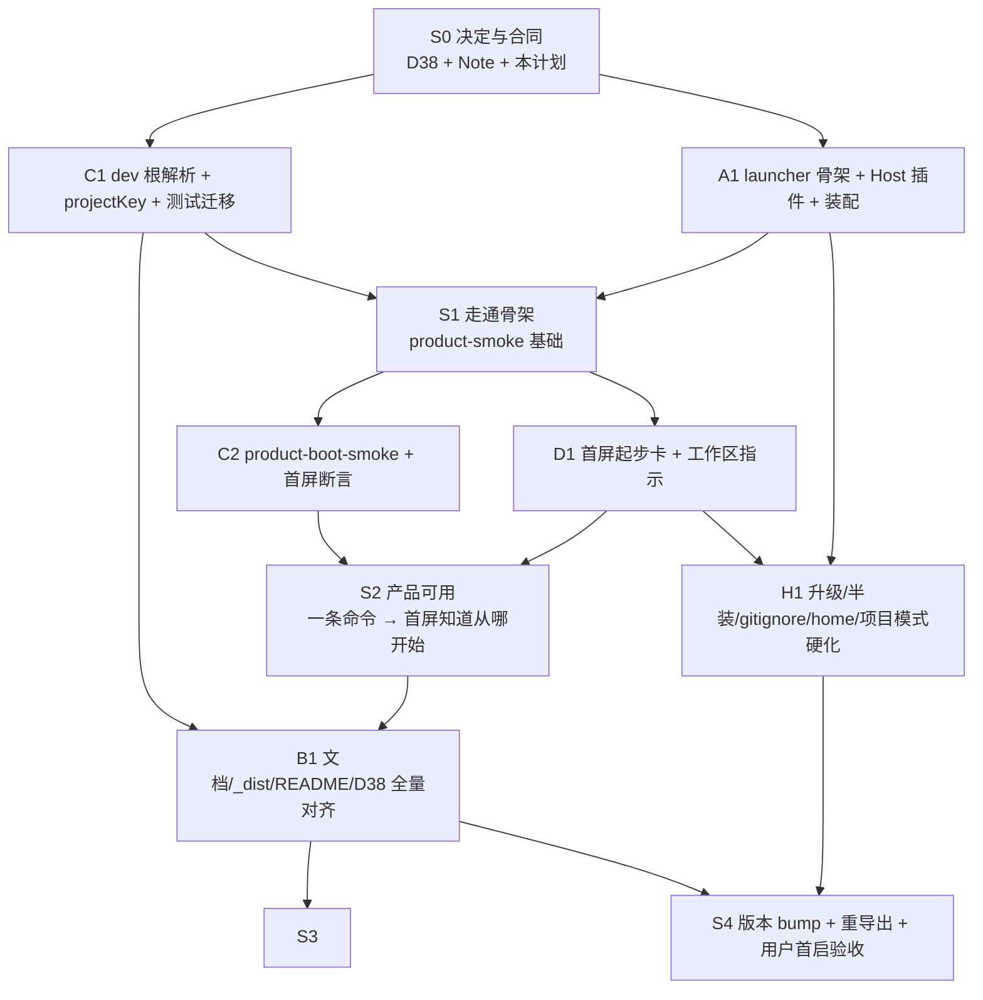

# 落地计划：从审批到产品可用的顺序

本文把[父卡](../../issues/2026-11-01-plugin-as-product.md)与四张子卡串成可执行顺序。原则：**每个切片结束都要有一个可运行的产品增量 + 证据**；不按"先写完所有代码再联调"推进。

## 0. 现状：已经摸透的与还没摸透的

### 已摸透（有真机证据）

| 事实 | 证据 |
|---|---|
| DSH 无第三方 profile 模板；launcher 必须 CLI 装配 | [机制核验](2026-11-01-dsh-mechanics.md) §1 |
| Web app 拒绝 `--workspace`；用 env 交 Host | 同上 §4 |
| Host 插件 boot 时 `workspaceRegistry.create` 可行；Web 首屏选中并建 blank Lead Session | [复核](2026-11-01-review-findings.md) §2.4；[运行时规格](2026-11-01-runtime-implementation-spec.md) §6.1 |
| 完整产品装配（web 模板 → pack → team layer → scaffold → Web）可跑通 | [复核](2026-11-01-review-findings.md) §2.5；本机临时 home/profile/workspace |
| 全局安装必须 optional peers；否则 ERESOLVE | 同上 §2.2 |
| 会话组 = `projectKey(cwd)` 确定性编码，不是 substring | [仓库规格](2026-11-01-repo-tooling-and-tests-spec.md) §2 |
| saved Session 会抢首屏（启动工作区 `ws`，saved 在 `ws2` → 打开 `ws2`） | [复核](2026-11-01-review-findings.md) §2.6 |

### 还没摸透（P0 不阻塞，但必须诚实）

- 真实 `npm i -g` 的 **launcher** bin（preflight/scaffold 已验证；launcher 加 bin 后补 `--help`/`--check`）。
- 团队层在离线/无 registry 环境的安装（沿用现有离线矩阵；product-smoke 缺前置 exit 2）。
- 项目子目录模式下用户是否接受"agent 可读项目、写入留子目录"（父卡 Q3，需用户拍板）。
- 共享 home 下其他 DSH 会话/工作区是否可接受（父卡 Q5，`--home` 是 escape hatch）。
- saved Session 自动切换（P1；P0 只做可见工作区指示/切换）。
- Windows / Desktop / 正式 npm 发布（P0 不承诺）。

## 1. 切片总览



| 切片 | 内容 | 卡片 | 结束判据 |
|---|---|---|---|
| **S0 决定与合同** | D38、Note、本落地计划、父卡翻「推敲中」 | 父卡 | 用户拍板 Q1/Q2/Q5/Q6/Q7；D38/Note 落盘 |
| **S1 走通骨架** | launcher 骨架 + Host 插件 + profile 装配 + 设置 + 打包；dev 根解析/projectKey 并行 | A + C1 | `dsh-deep-research --workspace <tmp>` 起 Web；profile/workspace/session 断言；`product-smoke` 基础绿 |
| **S2 产品可用** | 首屏起步卡 + 工作区指示 + 凭据提示；`product-boot-smoke` 浏览器断言 | D + C2 | 首屏 Orca/工作区/三步/Lead/composer；saved-session 有可见指示；无 pageerror |
| **S3 文档与分发** | README/pack README/_dist/00-index/61/62/65/project-map/terms；`_dist` 重导出 | B | `pnpm verify` 绿；`_dist` 手册与 tarball 一致；产品/开发作用域可辨 |
| **S4 硬化与验收** | 升级/半装/`.gitignore`/`--home`/项目模式；版本 bump；用户首启验收；L4 真 run | A/C/D/B | `release-smoke`、`product-smoke`、`product-boot-smoke` 绿；用户首启通过；真 run 作为后续 |

## 2. 切片细节

### S0 决定与合同（0.5–1 天）

1. 用户对父卡 Q1/Q2/Q5/Q6/Q7 拍板（profile 名、工作区 UX、home、首屏、种子副本）。
2. 写 D38（内容清单 = [文档规格](2026-11-01-docs-and-dist-spec.md) §9）与 `notes/implemented/` Note。
3. 父卡翻「推敲中」；四张子卡链接本计划与父卡。
4. 不改代码；只改 `docs/decisions.md`、`notes/`、backlog 状态。

**证据**：D38/Note 落盘；`pnpm verify` 绿（backlog/doc 门禁）。

### S1 走通骨架（3–5 天，A + C1 并行）

**A1（launcher/Host/打包）**

1. 抽 `scripts/lib/team-layer.mjs`（从 `scaffold.mjs:569-609`）；launcher 与 scaffold 共用。
2. `scripts/lib/launcher/{args,workspace,profile,settings,ui}.mjs` + `scripts/launch.mjs`：
   - flag/工作区解析/模式/守卫/设置/profile 装配/前置检查/spawn。
   - 先实现 `--check` 与 `--help`，再实现装配与 spawn。
3. `src/workspace-boot/index.ts` + `cordis.patch.yml` row + `exports`/tsdown/peer：
   - 按[运行时规格](2026-11-01-runtime-implementation-spec.md) §6；`apply` async；env 缺席零行为。
4. `package.json`：bin、files、所有 peer optional；`export-dist` inventory。
5. fake-dsh 单测：参数/工作区模式/装配命令序列/半装/设置/`--home`/危险目录。
6. 真实 `npm i -g` launcher bin 补测。

**C1（dev 工具，可并行）**

1. `scripts/lib/workspace-root.mjs`；`dev/boot-run.sh` 真正 `cd` 工作区；`run-kickoff:184`/`hitl-answer`/run-ops/run-gates 迁移。
2. `scripts/lib/session-log.mjs` 的 `projectKey`/`projectGroupDir`；`findGroup` 保留 legacy；`web-ui-nav`/四个 `--group` 默认迁移。
3. 测试：`projectKey` 多形态单测（spike 路径 `/private/tmp/dsh-product-boot/ws` → `--private-tmp-dsh-product-boot-ws--`）；任意工作区回归；legacy 用例。
4. 测试迁移（手册/模板读 pack 种子；`hitl1-intake-samples` 移 fixture；`run-driver-contract` 允许 launcher）。

**S1 结束判据**

- `dsh-deep-research --workspace <tmp> --profile <tmp> --check` 通过；非 `--check` 起 Web，`workspace.json` 有工作区，session header `cwd` = 工作区、`agentPreset` = `lead`。
- `product-smoke` 基础绿（装配/幂等/守卫/零写入）；`pnpm verify`/`pnpm test` 绿。
- `projectKey` 单测绿；dev 工具对任意 `DSH_RUN_WORKSPACE` 工作。

**走通骨架的证据模板**（本机 spike 已证，实施时固化）：

```text
SPIKE_REGISTERED /private/tmp/.../ws <workspaceId>
dsh web: http://127.0.0.1:<port>/?token=...
session header: {"cwd":"/private/tmp/.../ws","agentPreset":"lead"}
首屏: Orca | 工作区 ws | Deep Research Lead | [composer]
```

### S2 产品可用（2–3 天，D + C2）

1. `StartCard.tsx` + locale 键 + `conversation.input.dock` 注册（[首屏规格](2026-11-01-first-run-ux-spec.md)）。
2. 显示当前工作区/标题、三步起步、凭据提示；工作区有 `drt_*` 或用户消息时收起；不写 localStorage。
3. `product-boot-smoke` 固化：启动、认证、浏览器断言（品牌/工作区/起步/Lead/composer）、session header、saved-session 可见指示。
4. 首屏文案与 `product-smoke` 的 profile/workspace 断言同 diff。

**S2 结束判据**

- 新 home + 空工作区：首屏不是空白困惑页；有品牌/工作区/起步/凭据/Lead。
- 已有 run 的 workspace：起步卡收起；右栏研究状态可用。
- saved Session 在别的工作区：首屏有可见当前工作区 + 切换入口（不假装自动）。
- `product-boot-smoke` 绿；`pageerror` 为空；无新 localStorage/storage domain。

### S3 文档与分发（2–3 天，B）

1. 根 README（产品门面，预算处置）；pack README（部署/首屏/数据卡/卸载/de-repo）。
2. `export-dist.mjs` 模板重写 + `must` 加 launcher/workspace-boot；重导出 `_dist/安装手册.md`。
3. 00-index/61/62/65/project-map/design/terms/D38/Note/AGENTS/CONTRIBUTING/种子手册标题。
4. 预算：README 31→45、AGENTS 140→145（理由登记）；种子手册行数不净增。
5. `pnpm verify` 全绿；`_dist` 手册与 tarball 一致。

**S3 结束判据**

- 新用户按 README/`_dist` 能从零到"起 Web + 选工作区 + 首屏起步"。
- 产品/开发作用域在每页首段可辨；安装态不出现用户可执行的仓内脚本。
- `pnpm verify`（doc-budgets/md-links/md-anchors/entry-chain/backlog-liveness/dist-manual-version/release-version）绿。

### S4 硬化与验收（2–4 天）

1. 边界：半装/损坏 profile、旧版本 pack、用户改过的种子、已有 `.gitignore`、`--home`、项目子目录/`--in-place`、saved-session。
2. 版本 bump（0.1.3 → 0.2.0）+ root 镜像 + `release-check` + `_dist` 重导出。
3. `release-smoke`（安装域）+ `product-smoke` + `product-boot-smoke` 全绿。
4. 用户首启验收（真浏览器、真工作区；不需要模型）。
5. 真实研究 run（L4）作为后续，不作为 P0 关闭条件。

**S4 结束判据**

- 父卡 §验收标准 1–10 有证据；用户首启通过。
- 未验证项登记到 triggers/卡内，不冒充已证。

## 3. 并行与依赖

| 工作 | 可并行 | 依赖 |
|---|---|---|
| A1 launcher/Host/打包 | 与 C1 并行 | S0 拍板；pack 文件 |
| C1 dev 根解析/projectKey | 与 A1 并行 | 无（纯 dev） |
| D 首屏卡 | A1 接口（工作区/标题）+ C2 浏览器 harness；可先用 mock 开发 | A1/C2 |
| C2 product-smoke | A1 的 CLI 接口；可先写接口再转绿 | A1 |
| B 文档 | 可与 A/D 并行起草；最终依赖 A/D 的 flag/文案 | A/D 接口 |
| H 硬化 | A/D 基本完成后 | A/D |

**不要并行**：

- 不要在 A1 未定 CLI flag/设置路径时定稿 B 的用户命令。
- 不要在 D 未定首屏文案时定稿 README 首屏段。
- 不要先改 `_dist` 手册正文（生成物）；必须改生成器。

## 4. 卡片 → 切片映射

| 卡片 | 切片 | 先做 | 后做 |
|---|---|---|---|
| [父卡](../../issues/2026-11-01-plugin-as-product.md) | S0 | D38/Note/拍板 | S4 验收汇总 |
| [产品启动运行时](../../issues/2026-11-01-product-launch-runtime.md) | S1（A1） | launcher 骨架/ Host/打包/`--check` | S4 硬化 |
| [仓库对齐与证据](../../issues/2026-11-01-repo-alignment-and-evidence.md) | S1（C1）+ S2（C2） | 根解析/projectKey/测试迁移 | product-boot-smoke/首屏断言/S4 |
| [产品首屏体验](../../issues/2026-11-01-product-first-run-ux.md) | S2（D） | 起步卡/工作区指示/凭据提示 | saved-session 提示/文案打磨 |
| [产品文档与分发](../../issues/2026-11-01-product-docs-and-dist.md) | S3（B） | README/pack README/生成器 | 全仓叙事/D38/重导出 |

## 5. 第一刀（拍板后立刻做）

1. 写 D38 + Note（S0）。
2. 抽 `team-layer.mjs`；写 `launch.mjs` 的 `--help`/`--check`/flag 骨架（A1）。
3. 写 `product-smoke` 的"profile 不存在 → 检查失败"红用例（C2 红）。
4. 用 fake dsh 让 launcher 单测红→绿；再用真 `dsh`/pnpm 跑 `product-smoke`。
5. 加 Host row 与 `workspace-boot`；用本机 spike 的临时 home/workspace 复跑 S1 证据模板。

**第一刀不做什么**：首屏卡、文档重写、版本 bump、dev 工具全量迁移。它们属于后续切片，避免第一刀过大。

## 6. 证据与门禁（每切片必跑）

| 切片 | 命令 | 判据 |
|---|---|---|
| S0 | `pnpm verify` | backlog/doc 结构绿 |
| S1 | launcher 单测 + `product-smoke` + `pnpm test` | 装配/幂等/守卫/零写入；profile/workspace/session |
| S2 | `product-boot-smoke` + `client-load-smoke` | 首屏/工作区/Lead/composer；无 pageerror |
| S3 | `pnpm verify` + `_dist` 重导出 | 文档一致；手册/tarball 版本一致 |
| S4 | `release-smoke` + `product-smoke` + `product-boot-smoke` + `release-check` | 安装域/产品域/版本线全绿 |

## 7. 残余与回退

- 若真实 `npm i -g` launcher bin 失败 → 回父卡 Q4，评估独立 launcher 包（违反 D1，需新 D 号）。
- 若 saved Session 的可见指示仍不够 → P1 做 launch workspace 的 client 状态（Host Remote/URL 参数），不在 P0 硬塞。
- 若项目子目录 sandbox 不被用户接受 → 默认 `--in-place` 或只支持专用工作区；父卡 Q3 重议。
- 若团队层离线不可用 → 文档/启动器给补救；product-smoke 缺前置 exit 2，不报绿。
- 若 docs budget 升顶失败 → 先下放/压缩，README 只保留产品门面 + 一行开发入口。

## 8. 一句话

**先证明一条命令能把产品跑起来（S1），再证明首屏像产品（S2），再让文档/分发对齐（S3），最后硬化与验收（S4）；C1 的 dev 工具与 A1 并行，D/B 在接口稳定后跟进。**

## 9. 测试计划（落地保障，尾巴）

目标：每个切片的"完成"都有可复跑证据；**缺前置 = exit 2，不报绿**；不把"命令 exit 0"当"产品可用"。

### 9.1 测试层

| 层 | 名字 | 证明什么 | 入口 | 凭据/外部 | 判据 |
|---|---|---|---|---|---|
| T0 | 静态/契约 | 结构、文档、发布形状、backlog | `pnpm verify` | keyless | 全绿 |
| T1 | 纯单测 | launcher 逻辑、projectKey、Host 插件、设置 | `pnpm test` | keyless | 全绿，新用例有反证 |
| T2 | 安装面 | 真 `dsh`/pnpm/profile 装配、种子、幂等、守卫 | `scripts/smoke/product-smoke.mjs` | 需 pnpm + 团队层 registry/缓存；缺前置 exit 2 | 全绿 |
| T3 | 首启面 | 真 Web + 浏览器：注册、Lead session、首屏 | `scripts/smoke/product-boot-smoke.mjs` | 需浏览器（仓库 `.pnpm` 的 playwright）；无模型 | 全绿，pageerror 空 |
| T4 | 回归面 | 既有功能不被产品化破坏 | `pnpm test` + `release-smoke` + `preset-smoke`/`client-load-smoke`（按改动面） | keyless / 既有档位 | 全绿 |
| T5 | 分发音 | `_dist` tarball/手册一致、可安装 | `export-dist` + `dist-manual-version` + 手工/脚本装一次 | 需 npm pack；可离线 | 手册版本/条目/tarball sha 一致 |
| T6 | 人工验收 | 首启手感、文案、工作区选择、项目模式是否可接受 | 用户真浏览器 + 真工作区 | 人 | 用户确认 |

### 9.2 每张卡的最低测试集

| 卡 | T0 | T1 | T2 | T3 | T4 | T5 | T6 |
|---|---|---|---|---|---|---|---|
| A 运行时 | package-contract/data-plane/row-deps | launcher-* + workspace-boot | **必跑** | 必跑（依赖 A） | release-smoke | **必跑** | 首启 |
| D 首屏 | doc/entry-chain | — | — | **必跑** | client-load-smoke | — | **必跑** |
| C 仓库/证据 | backlog/doc | projectKey/workspace-root | **必跑** | **必跑** | pnpm test | — | — |
| B 文档/分发 | doc-budgets/md-links/dist-manual/release | — | — | — | — | **必跑** | 用户按 README 走一遍 |

### 9.3 `product-smoke` 用例（T2）

1. **首装**：空 `DSH_HOME` + 空 workspace + 空 profile → 一条命令装配 web+pack+team、种子、设置；exit 0。
2. **幂等**：再跑一次；无新增安装、无重写、exit 0。
3. **半装**：dependency 在、bundle 缺；或安装副本版本旧 → 读回失败/重装；不 exit 0 假绿。
4. **危险目录**：HOME/DSH_HOME/pack/profile/祖先/内部 → exit 2 + 补救。
5. **项目目录**：非空项目 → 默认 `<project>/research`；项目根文件不变；`--in-place` 才用项目根。
6. **已有 `.gitignore`**：不改写；建议规则可见；`--gitignore-append` 幂等追加标记块。
7. **`--check`**：零写盘；报告 profile/workspace/seed 状态；exit 0/1。
8. **`--home`**：profile/设置/子进程 `DSH_HOME` 一致；与默认 home 隔离。
9. **包目录零写入**：pack 的 presets/workspace/scripts/cordis.patch.yml 前后哈希一致。
10. **缺前置**：pnpm 缺失/团队层 registry 不可用 → exit 2，打印补救。

### 9.4 `product-boot-smoke` 用例（T3）

1. **首启**：新 home + 空 workspace → 起 Web；`workspace.json` 有 workspace；session header `cwd` = workspace、`agentPreset` = `lead`。
2. **首屏**：body 含 Orca、当前工作区、三步起步、凭据提示、`Deep Research Lead`；composer 可输入；`pageerror` 空。
3. **有 run**：预置 `drt_probe/` → 起步卡收起；右栏研究状态可用。
4. **saved-session 不匹配**：saved 在另一 workspace → 有可见当前工作区/切换入口（不要求自动切回）。
5. **中英 locale**：文案都在。
6. **工作区读失败**：卡片仍显示，不红错/不阻塞 composer。
7. **无 Documents 副作用**：临时 HOME 下不创建 `Documents/deepseek-harness/default-workspace`。
8. **清理**：停进程、端口回收、临时根删除；失败保留日志/截图。

### 9.5 反证与红先绿后

- 新测试/门禁先看到红：`product-smoke` 在 launcher 未实现时失败；`projectKey` 对任意路径先红；`package-contract` 对 optional peers 先红；`dist-manual-version` 对 launcher inventory 先红。
- 每道新门禁在 `gates-smoke` 有注入案例，或在 `tests/` 有等价反证；红灯记录写进交付 Note 的"实际跑过的验证"。
- 不允许"跳过/弱化断言"换绿；修复优先于放宽容差。

### 9.6 隔离、清理、安全

- 所有 smoke 用 `runtime/smoke-workspace/product-<pid>/` 临时根；路径守卫断言是预期路径才删。
- 不读真实 `~/.dsh`；不写真实 home；不读凭据值；不把 secret 打进日志。
- 浏览器用临时 context；不继承用户 localStorage；saved-session 用例显式 `addInitScript`。
- 端口用 `reclaimPort`；失败保留 `web.log`/截图/`workspace.json`/session header 尾部。
- 失败信息含：步骤、exit code、stderr 尾部、补救命令；不静默 catch。

### 9.7 CI/前置与时间预算

- T0/T1：无网络、无浏览器；`pnpm verify` + `pnpm test`。
- T2/T3：需 pnpm、团队层 registry/缓存、浏览器；缺前置 exit 2（不是绿）。
- 超时：T2 每步 180s；T3 启动 120s、浏览器 60s；超时杀进程组 + 回收端口。
- 新增 smoke 登记 `smoke-contract` 的档位（T2 = keyless+install；T3 = keyless+browser），不混入 REAL_MODEL。

### 9.8 完成定义（DoD）

- S0：D38/父卡结论落盘；`pnpm verify` 绿。
- S1：T1 + T2 绿；T3 的"注册 + Lead session"绿。
- S2：T3 全部用例绿；`client-load-smoke` 既有断言不回退。
- S3：T0 的文档/分发门禁绿；T5 手册/tarball 一致。
- S4：T2/T3/T4/T5 全绿；用户 T6 通过；未验证项登记 triggers/卡内。
- 每个切片结束在本计划/父卡追加一行"实际跑过的验证"；没有证据不算完成。

### 9.9 失败分诊

| 现象 | 先查 | 下一步 |
|---|---|---|
| profile 装配失败 | `dsh --dump-config` / profile package.json / pnpm 输出 | 半装修复；版本/pnpm 前置 |
| Web 起不来 | `web.log` 尾部 / 端口 / engines.dsh | 端口回收；DSH 版本；profile 组合 |
| 首屏无 Lead | session header `agentPreset` / registry default / 旧 blank session | 新开会话；profile bundle |
| 工作区不对 | `workspace.json` / saved `dsh.sessions.current` / launch env | 可见指示；P1 自动切换 |
| 首屏卡不显示 | `remote.workspaceFiles` / slot 注册 / locale key | client-load-smoke 同款断言 |
| `_dist` 手册漂移 | 生成器是否改、`dist-manual-version` | 重导出，不手改 |
