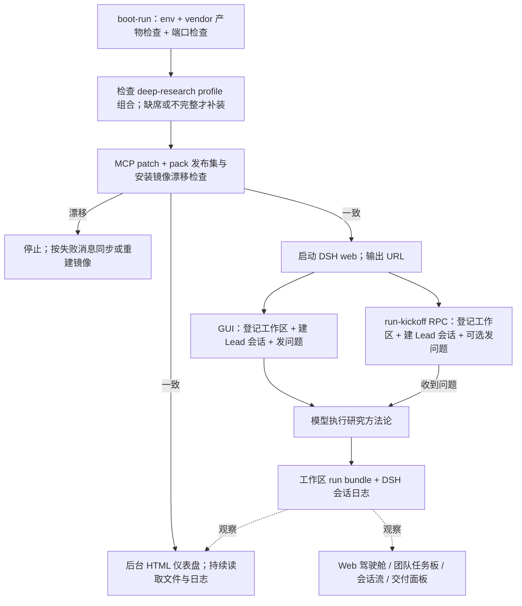

# Run 操作与排障指南（研究发起人入口）

> 层：指南（怎么操作、怎么追踪运行与排障）。通道 = run 通道（安装域 `deep-research` profile：本包 + vendor `agent-team-profile` 层，[毕业 Note](../../notes/implemented/2026-09-24-m2-p1-run-channel.md)）。
> **作用域**：本页服务 M2 开发通道（仓内 `deep-research` profile + `research-workspace/` + run-driver）与运行态排障。安装用户（`dsh --profile deep-research` + 任意工作区）看 [pack README](../../packages/deep-research-pack/README.md)、[`_dist/安装手册.md`](../../_dist/安装手册.md) 与 [contracts/run-forms.md](../contracts/run-forms.md)。
> 跨角色纪律与文件契约 = [研究手册](../../packages/deep-research-pack/content/manual.md)；节点 I/O 正本 = [NODES](../../packages/deep-research-pack/presets/lead/skills/nodes-contract/SKILL.md)；四类运行状态合同 = [contracts/data-model.md](../contracts/data-model.md)；2026-09-24 历史快照 = [m2-run-mechanics](../../notes/archived/2026-09-24-m2-run-mechanics.md)。

## 任务入口矩阵

每个任务只有一个首选入口；Agent Loop 与四类运行状态正本 = [contracts/data-model.md](../contracts/data-model.md)，节点 I/O = [NODES](../../packages/deep-research-pack/presets/lead/skills/nodes-contract/SKILL.md)，全档命令正本 = [dev-loop.md §2](./dev-loop.md)。

| 任务 | 首选入口 | 写盘 | 档位 | 事实来源 | 失败后的下一站 |
|---|---|---|---|---|---|
| **启动安装形态（安装用户）** | 按 [`_dist/安装手册.md`](../../_dist/安装手册.md)：CLI 建 profile（仅首次）→ `dsh plugin --profile deep-research add file:<tgz>`（当前唯一发布形态）→ 启动 → 首屏选项目目录；npm/Plugins 页/Discover 为 staged | 是（profile/会话/设置文件） | boot keyless；run 需凭据 | [pack README](../../packages/deep-research-pack/README.md) + [`_dist/安装手册.md`](../../_dist/安装手册.md) | 见 [run-forms](../contracts/run-forms.md)；诊断 = `dsh-deep-research-doctor` |
| 启动一次研究（开发通道） | `node tools/channel/run-driver.mjs up`（内部调 `bash tools/channel/boot-run.sh`；想守前台看日志才直接跑 boot-run） | 是（会话与 bundle） | boot keyless；run 需凭据 | 本页 §0 | boot 终端报错 → 下文「调试先看哪份事实」 |
| 继续在飞 run | 同上；起来后 lead 会话说「继续 \<slug\>」 | 是 | 同上 | bundle 文件 + 本页 §5 | bundle 缺件 → NODES 判据定位 |
| 观察在飞 run | boot 自带后台仪表盘 + Web 驾驶舱 | 只读投影 | 浏览器 | [contracts/client-ui.md](../contracts/client-ui.md) | 页签坏 → `client-load.entry` |
| 回答 HITL | Web GUI 选项卡（Web 面）；代理代答 = `tools/channel/hitl-answer.mjs`（开发面） | 是 | 浏览器；代答需真挂起在场 | 本页 §3 | 卡未弹 → `watch-run` 看挂起谓词 |
| 查看 run 状态与交付 | `<workspace>/drt_<slug>/` 文件事实（dev 实例 = `research-workspace/drt_<slug>/`；仪表盘只是投影） | 只读 | keyless | [NODES](../../packages/deep-research-pack/presets/lead/skills/nodes-contract/SKILL.md) | 交付不明 → `node-gate` 门②③ |
| 验证挂载（插件真挂载） | `source tools/env.sh && DSH_SMOKE_REAL=1 node checks/smoke/preset.e2e.mjs` | 否 | keyless 真挂载 | [dev-loop §2](./dev-loop.md) | 红 → preset 源 + `render-overlay` 后复跑 |
| 验证安装 | `source tools/env.sh && node checks/smoke/install-shape.entry.mjs`（手册 CLI 装包分支）/ `release.entry`（安装域） | 是（测试 home/profile） | keyless（`--install-only` 跳凭据） | [dev-loop §2](./dev-loop.md) | 红 → pack 发布集对账 |
| 验证首启（安装面） | `node checks/smoke/product-boot.entry.mjs`（真 Web + 浏览器，无模型） | 是（测试 home/workspace） | keyless + 浏览器 | [dev-loop §2](./dev-loop.md) | 红 → startup/StartCard/client 恢复 |
| 查漂移（镜像一致性） | boot-run 漂移门（启动即查，不静默用旧镜像）；复用通道时 `run-driver up/probe` 先跑 `boot-run --drift-only`（漂移 = NOT-RUN） | 否 | keyless | boot-run 输出 + run-driver verdict | 红 → 按失败消息同步或重建镜像 |
| 复现/验证一个机制（不是整链） | [probes/](../../probes/README.md) + [probe-playbook](./probe-playbook.md) | 证据默认写 `runtime/` | 真模型档/连已起 GUI/仪器 | [探针索引](../../probes/INDEX.generated.md) | 红/缺件 → 头注「何时跑」与指南 §5 |
| 定位故障 | 下文「调试先看哪份事实」与「症状 → 首个测试入口」 | 只读 | keyless | 现象 → 事实源映射 | 事实源看完仍不明 → `watch-run` / `node-gate` |

## 0. 开跑（一次性准备 + 每次启动）

- 凭据：真 run 需要模型——`runtime/harness-home/.credentials.yaml` 配一次
  `DEEPSEEK_API_KEY`（见 [AGENTS.md §硬红线](../../AGENTS.md)；boot 本身 keyless）。
  启动横幅出来后自查一步：`grep -q DEEPSEEK runtime/harness-home/.credentials.yaml`——
  boot 不查凭据，缺了要到 lead 首次调模型才炸（启动成功 ≠ 能跑研究）；
- 启动：`node tools/channel/run-driver.mjs up`（起/复用通道 → 验浏览器面 → 打印呈交块；冷启动 fork
  [start-channel supervisor](../../tools/channel/start-channel.mjs) 做自检/组合/漂移门）→ 用浏览器打开呈交块里的
  `http://127.0.0.1:<port>/?token=…`。**端口 = `DSH_RUN_PORT`，缺省 3083**
  （3080 = 本仓开发 GUI、3081 = 已让渡外部项目，均勿占；换端口：
  `DSH_RUN_PORT=<空闲端口> node tools/channel/run-driver.mjs up`）。端口已被占时 boot-run 会 fail-loud 并给
  补救，**先看占用者是谁**：若是本仓在飞的 run 通道 → **别另起**，用它（URL/token 见启动横幅或
  `runtime/smoke-workspace/web.log`）；不是 → 换端口，或确认后停掉它（**别盲杀**：在飞会话的
  日志尾部可能丢失——BUG-007 卡）。想守在前台看日志 = `bash tools/channel/boot-run.sh`（底层启动面）；
- **环境不变式（2026-11-05 用户定调）**：启动一律落在**隔离 dev home**（`tools/env.sh` 把 `DSH_HOME`
  指到 `runtime/harness-home`，绝不落到日用 `~/.dsh`；换实例用 `DSH_DEV_HOME`），且载入路径
  **尽量与用户安装同形**：CLI 建 profile → `dsh plugin --profile deep-research add file:<tgz>` →
  `dsh --profile deep-research`。dev-only 差异只许是 [tools/README 的 parity 表](../../tools/README.md)
  登记过的那几项（MCP Playwright overlay / 观测 / 端口 / 源码 runtime）；要更严格地"当用户"验，
  走安装形态冒烟（`install-shape.entry` / `product-boot.entry` / `release.entry`）；
- **启动次序（DSH 原生顺序，dev 通道不得重排）**：① 建 profile（CLI，仅首次；已有 profile **不要**
  重复 `--from-default-profile`，那是破坏性替换）→ ② `dsh plugin --profile deep-research add …` 写
  roster（bundle membership 变更**必须重启**才生效）→ ③ `dsh --profile deep-research` 起 web
  （Host 读 roster → web app → 本包 client 插件）→ ④ 首屏选工作区 → 建会话。supervisor 先取锁并自检，
  再准备组合，在 ② 与 ③ 之间加漂移门/MCP overlay；验证缓存与探针只跳过"重复验证"，**不跳过任何一步**（冷启动走全序）。
  **不得自创**：不手起 `dsh --profile deep-research`（dev 绕漂移门）、不对已有 profile 重复
  `--from-default-profile`、不手写/改 `dsh.profile.bundles`（roster 只经 `dsh plugin add/remove`）、
  roster 变更后不跳过重启；
- **已有通道时**：取当前 URL = `node tools/channel/run-driver.mjs url`；只验浏览器面（不启动、不换 token）=
  `node tools/channel/run-driver.mjs probe`。probe/up 复用通道时先跑镜像门（`boot-run --drift-only`，可并发，
  不修改活 profile，但会写原子发布清单缓存，详见 §0.1）：
  通道镜像 ≠ 当前 pack 源时，`up` 对纯 client/文档漂移自动 `--sync-mirror` 原子同步（不重启、不换 token）再验；
  host 侧漂移仍 **exit 2 未跑**（不是绿）——旧页面验不出当前代码，先重建/重启再验。
  URL/token 的唯一来源仍是最后一条启动横幅；旧横幅 = 旧 token；
- **启动三分支（先判"通道活没活 + 镜像一不一致"，再动手）**（实测 2026-11-05：缓存热复用 ≈0.5s，
  冷启动缓存命中 ≈10s，缓存过期后真验 ≈20–25s，冷重建 ≈2–3 min；2026-11-26 BUG-435：client 漂移
  同步恢复 ≈2.6s，含真探针的完整 up ≈15s）：
  - 通道活 + 镜像一致 → `up` 复用，按缓存条件复用 GREEN 或跑探针；只要当前 URL = `node tools/channel/run-driver.mjs url`（≈0.2s）；
  - 通道活 + 镜像漂移 → 分两类：**纯 client 产物/非运行时文档漂移**（改驾驶舱源码重建 lib 的日常形态）：
    `up` 自动 `--sync-mirror` 原子同步 + 热载就绪检查后验面，不重启、不换 token，旧 URL 与已打开页面继续有效
    （vendor client-hmr stat-poll 热载，页面自动更新）；**host 侧运行时漂移**（lib host 半/presets/content/yml 等）：
    `up` 判 exit 2——运行进程 boot 时缓存 host 代码，同步盘上文件不更新加载面；确认在飞 run 的处置后停止所属
    supervisor，核实相关进程全部停止，再离线核对实际 home/profile 路径并重建镜像，随后重跑 `up`；
    停止与异常残留的边界见 §0.1；
  - 通道死 → 无锁残留时直接 `up`（它 fork 同一个 supervisor）；锁残留须先按 §0.1 离线恢复。
    **别手起 `dsh --profile deep-research`**，那会绕漂移门与 ownership；
- **运行时与验证缓存（加速的事实边界）**：boot-run 默认用 **vendor 构建产物** `lib/bin.js` 启动
  （同一 pin 源码编译，≈3s；`DSH_RUN_RUNTIME=source` 退回 tsx 源码 ≈13s）——仍是同一条
  `dsh --profile deep-research` 启动面与同一 roster。
  `up` 在"同一 pack 源 + 同一 runtime 构建 + 最近一次 GREEN 在 30 分钟内"时直接复用该结论
  （打印"呈交块（缓存）"），**冷启动同样命中**；命中前仍做一次 HTTP 就绪检查（token→cookie 后读首页）。
  `--force-probe` 强制真验；缓存**只存 GREEN**——NOT-RUN/红从不入缓存；`probe` 子命令永远真验；
  发布清单也按 pack 源指纹缓存（漂移门 ≈5s → ≈0.7s）；
- **判定分流（红 ≠ 未跑）**：exit 2 = 未跑（前置缺席：镜像漂移/无通道），按上一条处置；exit 1 = 红——
  先读 `verdict.checks` 与 `runtime/smoke-workspace/run-verdicts/` 最近几份（同一检查连续红 =
  多为探针/环境口径，不是当次启动引入），再用两条人话判据复核插件：preset 选单含四个研究角色、
  会话右栏有「研究状态」页签。先分清是**探针判据**还是**插件没挂上**，修好判据后重跑同一条命令；
- **启动请求的呈交纪律（2026-09-30 用户定调）**：用户让"启动/起 web" = 代理**先自己跑通再交 URL**——
  run-driver 就是这条纪律的可复跑入口（exit 0 = 可呈交 / 1 = 红不得呈交 / 2 = 未跑）。三步序如下，
  红了按序修后重跑同一条：
  ① supervisor 执行 boot 全序（自检 → 组合检查/必要补装 → 漂移检测）红了当场修——漂移 = 按 §0.1
  先停服务、核实后离线重建 profile；vendor 产物缺失 = `bash tools/build/vendor-build.sh`；
  ② boot 出横幅后验浏览器面：探针断言宿主就位 / **首屏无遮挡**（DSH 版本升级后的 Preview Notice
  全屏遮罩必须关掉——探针的 JS 派发绕过可点性检查，不关则绿的是 DOM、不是人看得见的页面）/
  零 console 错误（boot 横幅只证宿主侧，观察面可能坏着——0.2.0 轮教训）；
  ③ 全绿才把 URL 交出去（人话判据：GUI 里 preset 选单含四个 Deep Research 角色、会话右栏有
  「研究状态」页签——任一缺席 = 插件没挂上）。不呈交"可能能用的东西"；红了不自修就上报 = 失职；
- **启动前先判"接续还是新开"**：`find research-workspace -maxdepth 2 -type d -name 'drt_*'`
  ——根 / `archive/` / `_abandoned/` 三类操作桶都扫（位置只用于发现，D28）；**每个候选都要
  报出来**，按内容分两类：(a) 无 `final/` 或 `review.md` 不是 `readiness: PASS` = **在飞**
  （含停在 HITL2 等拍板的形态——`final/` 记账随交付动作〔拍板行 → run 根 final.md + 记账 →
  present → goal complete〕落地，交付前不在场；扩张版 vN 随 rerun）→ 问"接续它还是新开"
  （接续做法 = §5）；(b) 有 `final/` 且 PASS = **交付线已在盘**——按 [NODES](../../packages/deep-research-pack/presets/lead/skills/nodes-contract/SKILL.md)
  交付行，交付判别 = §6（`final/vN` + `deliverables/presented` + 回执）→ 问"先归档再新开，
  还是补研究（rerun）"。两类都带上 slug + 操作桶 + 最新 journal 日期，**都不自己挑**；
  present 原始事件不在 bundle 文件里（`deliverables/presented`），(b) 类归档前请用户确认。

### 0.1 特殊形态与排障（按需读，首跑不需要）

- **SPA 抓取通道（mcp-playwright，默认挂载）**：`bash tools/channel/boot-run.sh` 自带本地 Playwright MCP
  （npx 拉起 `@0.0.83`、headless——SPA 定价页/JS 榜单的渲染抓取；不设任何代理参数，浏览器网络
  继承环境）；`MCP_PLAYWRIGHT=0` = 显式拆。决定与环境踩坑正本 =
  [mcp-playwright 采纳 Note](../../notes/archived/2026-10-02-mcp-playwright-adoption.md)；
- **网络 = 原生 DSH 行为（零干预）**：boot-run 不探测网络形态、不设任何代理 env、不起任何代理
  进程——代理路由（vendor `util/http-proxy` 原生读 `http_proxy`/`https_proxy`/`no_proxy`）与 SSRF
  守卫都是 vendor 缺省行为，设不设代理完全由用户环境决定。环境处于 TUN/fake-IP 态时 `web_fetch`
  可能被原生守卫拒（`web_search` 不受影响）——那是环境形态问题，换网络环境即可，本仓不干预；
  用户自设代理 env 时 LLM SSE 流可能被撕裂（BUG-023 教训——遇「event precedes message_start」
  先查代理路径，不要先怀疑上游）。零干预的理由与拆掉的方案 =
  [网络零干预 Note](../../notes/rejected/2026-10-13-network-vanilla-restore.md)；
  - **出问题第一步 = 诊断**：先把「哪场 run」变成「哪个会话」——`node probes/analyze/bundle-sessions.mjs <bundle|slug>`（bundle 不记会话 id，这是唯一反查入口；判据 = 写过 `drt_<slug>/` 的 lead 会话，并直接打印下一步命令）；再 `node probes/analyze/stream-diagnostics.mjs --session <标题|id>`（或 `--recent N`）——输出模型尝试时间线、失败密度、provider/重试策略实名、该会话的工具调用与检索查询。判定行直接给"链路/上游态 vs 间歇性"。
- **启动 owner 与服务生命周期**：前台入口 [boot-run.sh](../../tools/channel/boot-run.sh) 自 source env.sh 后
  `exec` 同一个 [start-channel supervisor](../../tools/channel/start-channel.mjs)；run-driver 冷启动 fork 它，
  以本代 READY/交接确认启动成功。交接前 driver 取消或断连会收束启动，交接后服务独立于 driver 存活。
  [boot-run-body.sh](../../tools/channel/boot-run-body.sh) 是私有实现库，由 supervisor source 后调用；直接执行 exit 2。
- **前台与停止**：交互式运行 `bash tools/channel/boot-run.sh`，Ctrl-C 请求 supervisor 停止；也可用托管后台 job
  运行同一入口。run-driver 后台启动时，本次 state 的 `run-driver.pid` 记录 supervisor PID，须核实进程身份后
  向该 supervisor 请求停止。supervisor 回收整个子进程组，确认 body、web、仪表盘等相关进程静默后才释放锁。
- **锁与离线恢复**：supervisor 在准备前对 canonical home/state 各取 `channel-start.lock`，完整服务生命期持续持有；
  同 home 不同 state/profile 也保守串行，独立 home/state 才可并发（实例变量见 [contracts/run-forms.md §7](../contracts/run-forms.md#7-独立环境与多实例)）。
  锁在场即拒绝进入；没有 stale/PID/TTL 自动接管，owner 元数据缺失或损坏同样阻断。crash 或无法证明子进程组静默时
  保留锁；旧 `boot-run.lock` / `run-driver-up.lock` 也要求离线恢复。先确认该 home/state 的所有相关进程全部停止，
  再核对 canonical 路径与残留内容后人工恢复；不要在线删锁，也不要把 PID 消失或经过一段时间当成可接管证明。
- **单跑模式**：`--prepare-profile` 只准备/校验，`--drift-check` 检查端口且可补装 profile/生成 dev overlay，
  两者都由 supervisor 持锁执行到退出。`bash tools/channel/boot-run.sh --drift-only` 不取启动锁，可与活通道并发，
  不检查端口、不安装、不改活 profile、不起 web；它会确保 home/state 目录，miss 时写 npm cache 并以临时文件 + rename
  原子发布 `pack-shipped.json`，因此并非无写入。判红只看运行时文件（`lib/`/presets/content/locale/cordis.patch.yml 等）；
  README/LICENSE/*.d.ts 漂移只提示。`bash tools/channel/boot-run.sh --sync-mirror` 是漂移恢复快路径（BUG-435）：
  同一道发布集比对，client 产物/非运行时文档漂移 → 逐文件原子同步（temp + rename）后复验，host 运行时漂移 → 拒绝
  （须停止 + 重建）；与 `--drift-only` 一样不取启动锁、可与活通道并发，是服务持锁期间唯一允许的镜像写。
  client 产物由 vendor client-hmr（500ms stat-poll）热载，不重启、不换 token；分类判据 =
  [mirror-sync.mjs](../../checks/lib/channel/mirror-sync.mjs)。报漂移后的镜像重建先遵守上面的停止与离线核实步骤，
  影响面见 [guides/plugin-authoring.md](./plugin-authoring.md)。
- **刷新白屏的判别序**：① `lsof -nP -iTCP:<端口> -sTCP:LISTEN` 有没有监听 → 无 = 进程已停
  （重跑上面任一形态）；② 有监听但仍白屏/401 = token 过期（**每次启动都是新 token**，
  用当次横幅里的 URL；旧 URL 作废）；③ 有监听且 token 新但页面空 = 前端壳产物陈旧
  （`pnpm --filter @deepseek-ai/dsh-web-frontend run build` 重建；vendor 构建产物整体重建 =
  `bash tools/build/vendor-build.sh`，见 [guides/dev-loop.md §2](./dev-loop.md)）。

## 1. 开哪个会话

**前置（一次）：把研究工作区注册进 DSH**——侧栏只列已注册的工作区，未注册的目录在
"新建会话"里选不到、其会话也不进侧栏（[实测根因](../../notes/archived/2026-09-26-bundle-face-wiring.md)）。

```sh
# 经 GUI：Workspaces 面板的 + 添加 research-workspace/ 目录；或经 RPC：
#   workspace/create { request: { path: "<repo>/research-workspace" } }（幂等）
```

**自检 / 补登记**：`tools/channel/run-kickoff.mjs` 建会话前就调 `workspace/create`（幂等，RPC 同上）——
"这台机器登记过没有"不用记；`runtime/harness-home` 被重建后本步重新需要。

**为什么关键**：研究手册随包（`content/manual.md`），由本包的 content 行经
`systemPrompt.context` 注入每个角色，**与会话 cwd 无关**；工作区登记决定的是**角色会话的 cwd**
——cwd 不在研究工作区，`drt_<slug>/` 就写不到用户工作区。`tools/channel/run-kickoff.mjs` 已默认用
workspaceId 形态把会话建在 research-workspace。

- web GUI 新建会话：preset 选 Deep Research Lead（默认项），工作区选 research-workspace；
- 无 GUI 手（代理操作）：`node tools/channel/run-kickoff.mjs --port 3083 --token <横幅 token>
  [--prompt-file <file>]` 建 Lead 会话（workspace/create 幂等自检已内建；全档参数 =
  [guides/dev-loop.md §2](./dev-loop.md)）；
- 只跟 lead 对话——它是唯一入口与出口：立项、组队、派活、综合、交付全归它；
  scout / analyst / critic 是它的队员，不直接听你指挥。

## 2. 说什么

- 直接说出研究问题（一句话到一段话皆可）。lead 加载 research-brief skill 走 **HITL1 两段卡**：
  第一段**三问**——研究类型（quick_factual / exploratory_map / claim_verification）/ 深度篇幅 /
  时间口径语言，**一张结构化选项卡**（一次 ask_user_question 携带三问，每问 options
  化、推荐项置首带(Recommended)），你点选项即拍板（需要改的选项可自由输入）；
- 三问答毕 lead 实例化 run bundle `research-workspace/drt_<slug>/`（question.md 定稿 +
  topics.md 拆解；立项时 sibling 预检——同名/前缀相关 bundle 已在则先问你），随后发
  **第二段·计划确认卡**（quick_factual 豁免）：≤200 字计划要点瘦卡 +「全文 =
  question.md / topics.md」指针，三选项——按计划开跑(Recommended)/ 修订计划（自由文本
  意见，**附加**进计划不替换）/ 放弃（不开跑，bundle 处置照 sibling 预检规矩）；修订意见
  逐字落 §Decisions 后直接开工（一轮制，不再二次呈卡）；
- 计划拍板后 lead 组队（scout 先行，critic 后置进场），进入静默自主区。

## 3. 静默自主区（两点之间你会看到什么）

- 角色不问你、不汇报进度、不等确认（两点交互纪律）；你主动发消息会被直接回答，
  但不改变既定方向与分派；
- 进度看四处（**被动观察**——不构成第三个交互点，不从观察面向角色发指令）。两层关系：
  **在场看 Web**（下 1–4，驾驶舱为主面）；**离机看投影** = boot-run 自动起的
  `runtime/smoke-workspace/dashboard.html`（fail-soft 只读，不是交付判据）：
  1. 研究驾驶舱「研究状态」页签（**主观察面**——流程轨道 / 活动流 / 活标题 / HITL 挂起横幅，
     构成正本 = [contracts/client-ui.md](../contracts/client-ui.md)）；
  2. 各角色会话的实时消息流（scout 的搜索调用、analyst 的抓取逐条可见）；
  3. `ui-agent-team` 任务板（谁领了什么活、起止状态）；
  4. deliverables 面板（final.md 交付后出现）。

**用户不在场时代答（代理模拟）**：HITL 的 answerer 只有连着 web 的浏览器客户端（vendor 实测：
CLI/host 侧没有 answerer，也没有提交答案的 RPC）——所以代答要用真浏览器：

```sh
source tools/env.sh && node --import tsx/esm tools/channel/hitl-answer.mjs --port 3083 --token <横幅 token>   # 默认逐题选带(Recommended)的那一项
```

**HITL1 是两段卡**（三问卡 → 计划确认卡）：同一条命令**跑两次**，每次只答当前挂起的一张卡
（计划确认卡在 quick_factual 编制下豁免）。**HITL2** 先按 §4 跑 `node-gate` / `evidence-audit`，
再跑同一条 `hitl-answer`——交付审阅卡在 review readiness 非 PASS 时自拒（exit 4）。

> **交付代答闸**（2026-10-18）：交付审阅卡在场而 review readiness 非 PASS 时，`hitl-answer` 的**默认推荐档会自拒**（exit 4）——请人工裁决，或显式 `--pick <非定稿项>`/`--custom` 表明有意为之（依据 = [hitl-proxy-delivery-guard](../../notes/archived/2026-10-18-hitl-proxy-delivery-guard.md)）。

它逐题打印选择结果；**必须**把这次代答如实记进 bundle 的 `question.md` §Decisions 与
`journal.md`，标注"代理模拟"（它替的是人，不是人）。HITL1 与 HITL2 都走同一条命令。
代答是否成功以工具尾部的**盘侧裁决**退出码为准（0 = answer 落地 / 1 = 未落地），UI 自报不算数。

选会话语义（多 run 并存时必读）：默认在 research-workspace 组最新 15 个日志中选择最新的 lead 挂起会话；
`--session <标题子串>` 在同一窗口内唯一匹配仍挂起的会话。盘侧判决、UI 行定位与 provenance 共用该会话的
canonical 日志 ID；未匹配、歧义、非挂起或侧栏找不到目标行时均拒绝作答。
落账归属 = 被答会话**写命中**的 bundle（仅写才落盘；仅读/无绑定响亮延迟，操作侧按打印内容补记——
BUG-020）。

**应答通道按 ask 形态二分**（形态 = 盘侧 ask 参数，hitl-answer 的驱动计划会打印）：timed 形态
（缺省 600s）超时转 pending 后，真浏览器与文本消息两条路都通；活等待（`wait: -1`）只有真浏览器
一条路——对活等待发文本消息只会 splice 进 next-turn，而挂起的回合永不收尾，消息永不被消费。

## 4. HITL2（交付审阅）

- **拍板前操作侧先跑机械门**：`source tools/env.sh && node checks/run-gates/node-gate.mjs
  research-workspace/drt_<slug>`——门①/③/L/R 红在场 = 先让 lead 原位修再拍板（红门会
  穿过 HITL2 落地，lead 自己跑不了门：无 bash）。**门②/④/A/C 属拍板后判据**：门②查 present
  声明、门④查版本副本、门A 查交付完整性（v1 副本 + audit.md + 副本×readiness 交叉）、
  门C 查读者版合同（`final/readable-vN.md` 与 `final/vN` 同版），在拍板前必然缺席——拍板前
  跑门看到 ②/④/A/C 红或 N/A（静默缺席形态）= 预期态而非缺陷，拍板交付后复跑转绿
  （门清单正本 = NODES.md 头部图例）；
- **拍板前操作侧跑证据审计**（须先 `source tools/env.sh`）：`node checks/run-gates/evidence-audit.mjs
  research-workspace/drt_<slug> --write`——默认只读，`--write` 才落 bundle 的 audit.md，**CRITICAL=0 才带审阅建议
  进 HITL2**（审计判据正本 = 研究手册「机械强度诚实记账」节）；CRITICAL>0 = 证据链有
  伪造/断链，先让 lead 修证据再回来；review 的 readiness 若为**附条件 PASS**，node-gate
  门A 会带 ⚠ 注记显性化——拍板时先核条件（裁决归你，机械门不替你拦）；
- **保留期视图（只读）**：`node probes/analyze/run-inventory.mjs --workspace research-workspace` 列出每场
  run 的文件数/大小/最老日期与合计（`--json` 给脚本）；它不删除任何文件，删/归档仍是显式动作。
- **拍板后操作侧跑一次验收（原子动作）**：`source tools/env.sh && node checks/run-gates/run-accept.mjs
  research-workspace/drt_<slug>`——node-gate + evidence-audit + path-hygiene（本机 home 路径）+ 未来日期 sanity 同次跑；预检红不写，绿写
  `delivered.json` + `manifest.json` + `acceptance.md`（新 run 非 quick_factual 的 reader 角色/哈希一并绑定）；`acceptance.md` 的「人工走查」节是 L4 ③④ 的唯一载体，重跑验收与 `--repair` 保留该节；回执里 present 只记
  `drt_<slug>/final/vN` 相对标签，不写本机绝对路径；落盘后还会复检一次门禁/审计生成物。复核后加 `--archive` 才移入
  `archive/drt_<slug>/`。门 A/C、审计或日期红时不要手工归档。历史 bundle 的旧回执若已带绝对路径，用 `--repair` 显式修
  （只归一化 delivered.json 并删除可再生的 acceptance/node-gate，再走同一套预检）。
- **拍板前先读读者版**：review 终局 PASS 后、HITL2 前，Lead 已按 `reader-final` skill 写
  `final/readable.md`；「终稿」页签默认显示读者版，`看审计版` 可切回 `final/vN`（未交付时
  `final.md`）。读者版是决策面，canonical 是审计源；两份不一致以 canonical 为准。
- lead 带审阅建议来找你：证据充分性判断 + 交付/补研究推荐 + composition 确认
  （读者是谁 / 用来做什么 / 前景化重点）——拍板后落 `final/vN` 交付副本，再把
  `final/readable.md` 复制为 `final/readable-vN.md`（同版），present 两份
  （reader 第一、canonical 第二；门A/门C 交付件齐的最后一环）；`final.md` 是工作稿，不冒充交付；
- 每条关键结论带 `[来源: evidence/xx.md]`，critic 的 review.md readiness: PASS
  是交付前置（无 CRITICAL 未修复才许交付）；
- **HITL 超时语义（0.2.0 timed ask-user，600s）**：两点挂起 600s 未答 → 工具返回
  pending，**问题保持可答**（挂起横幅仍在——hitl-fold v5 把 timed 超时仍判挂起），lead
  可继续有用工作但 pending 通知明示"这不是许可"；你之后随时可答，答复作为新消息唤醒
  会话。**不是**按推荐项自动落定。timed 放行是无人值守 run 的生命线：lead persona 的
  ask 硬约束（禁 `wait: -1`，模型单参即可拆掉它）由回归测试钉住——形态判别与救活路径
  的机制依据 = BUG-005（[goal-hitl-alignment Note](../../notes/implemented/2026-11-10-goal-hitl-alignment.md)）。
  等待判据：`watch-run` 的状态行带 `hitlAgeMs`，挂起时另打 `STATE-NOTE: HITL 已等待 N 分钟`——
  600s 超时后仍显示挂起是预期（问题保持可答），不是"卡死"；判卡死看年龄 + 日志回退。

## 5. 中断与恢复

四类运行状态（run bundle / session log / goal·任务板 / 观察面）的 canonical 合同与恢复优先级正本 = [contracts/data-model.md](../contracts/data-model.md)——本节只载人的操作步骤。

- 任何时候可关页面/停机。恢复 = 重跑 `node tools/channel/run-driver.mjs up` → 新开 lead 会话说
  "继续 <slug> 这个 run"——lead 只凭 `drt_<slug>/` 的文件事实重建上下文，
  不依赖聊天记忆；
- **通道还活着、只是回合停摆**（模型空响应 / 厂商流错误打断，会话未终局化）→ **不必新开**：
  `node tools/channel/run-kickoff.mjs --port 3083 --token <t> --session <会话 id> --prompt <恢复指令>`
  即向该会话注入指令唤醒（等价于你在 GUI 手打一句）。该模式**自带送达对账**：exit 0 =
  会话日志里已出现这条 `user/message`，1 = 未对账（多半是该会话已终局化或日志尾部未落盘
  → 走上面"重跑 + 新会话"那条路），2 = 用法/前置错（续跑模式需先 `source tools/env.sh`）；
- **通道跑久后 UI 可能"零会话行"**（实测约 5 小时后：侧栏组能展开成 `aria-expanded=true`，却渲染不出任何
  `session:` 行；代答于是报"侧栏没有目标会话行"）——**不是**归档、也不是回合终局化。处置 = 重跑
  `node tools/channel/run-driver.mjs up` + **新会话**；`hitl-answer` 自 2026-10-16 起在报错里给「错因判据 = aging」这一行
  （BUG-031；机制与 aging 判据见 `tools/channel/hitl-answer.mjs`）；
- **被通道重启打断的 ask 不会终局化，会永久留在盘上算 pending**（UI 卡在场但点不动、答复永不落地，盘侧谓词会继续
  把它当"最新挂起"报出）→ 别去答它：重开新会话说"继续 <slug> 这个 run"，让 lead 原样重发问询；
- **会话日志尾部在通道死亡时不保证**（SIGTERM 后未落盘缓冲蒸发实测）——"文件即真相"只对
  bundle 文件断言；盘侧谓词消费日志前先过回退检测（watch-run 内建，回退即 fail-loud），
  跨会话取证的结论要意识到日志可能被截断（BUG-007，[vendor-wire-semantics-and-log-tail Note](../../notes/implemented/2026-11-24-vendor-wire-semantics-and-log-tail.md)）；
- **run 目标态（0.2.0 tool-goal）**：HITL1 拍板后 lead 用 create_goal 钉住本次 run
  （objective = 定稿问题 + 交付判据）——goal-round-driver 随 base 在位，会话存活期中断的
  回合由 goal 驱动续轮（韧性增益；goal 语义随 run 生效有实测）；**通道死亡场景以文件恢复
  为准，不假设自动续轮**（通道死亡下续轮未单独实测——机制描述须有盘面支撑，
  BUG-009（[goal-hitl-alignment Note](../../notes/implemented/2026-11-10-goal-hitl-alignment.md)）同款教训）；
  HITL2 用 `ask_user_question` 的 `timeout: -1` 保持开放回合（答案未到不进交付；goal 轮
  不空转；无人值守时保持 pending、不烧模型调用）；lead 不再 pause/resume goal——模型不能
  resume durable paused goal，goal 从 HITL1 后保持 active，交付时 complete；
  goal 与 drt_ bundle 互为镜像、冲突以 bundle 文件事实为准；
- **位置 = 操作桶（D28）**：根 / `archive/` / `_abandoned/` 只用于发现与展示，不证明交付；
  交付由 `final/vN` + `deliverables/presented` + `delivered.json`/`acceptance.md` 判定。归档 =
  操作侧 `run-accept --archive` 的桶移动（归档不消失——仪表盘多 run 总表与 evidence-audit
  `--latest` 均并扫 archive/）。`runtime/harness-home/runs/` 下的 bundle 是契约前的 ad-hoc 历史
  （仪表盘标 "ad-hoc·无契约"）——不是这次要恢复的 run，也不要删（gitignored 运行数据，是那次
  研究留下的证据）；
- **交付后想改**：三种改法 + 各自代价（补研究出新版本 / 改说法版本不变 / 方向变了另起 bundle）——
  状态页 ⑤ 与终稿页脚有只读折叠块「还不满意？三种改法」，照抄一句发给 Lead 即可；Lead 按
  `rerun-triage` skill 分诊（先复述再分类、至多两个手段、不擅自 rerun）。观察面只给话术，不按钮化。
- **续跑已交付（已归档）run**：同在飞形态——新开 lead 会话说「继续 `archive/drt_<slug>` 这个 run」；
  lead 依赖的是 bundle 文件事实而非位置（归档位在其 cwd 之下可读；仪表盘与 evidence-audit
  `--latest` 均并扫 archive/）。续跑语义 = rerun 三分：表述修订原位改、证据扩张落 `final/`
  v(n+1)（交付后操作侧重新归档）、结构性另起新 bundle（正本 =
  [NODES 回边版本语义](../../packages/deep-research-pack/presets/lead/skills/nodes-contract/SKILL.md)）；候选不止一个时全部报出问用户，
  不自己挑（同 §0 纪律）；
- **rerun 版本面**：同 bundle rerun 开工时 lead 在 `question.md` 标题下写
  `> rerun: v2 · evidence-expansion · 日期 · 触发：…`；plan 每次重写前把旧版落 `plan/vN.md`
  （头部 `图版本：vN` 与重写记录同号；快照编号必须小于当前版本）。观察面按这些盘上声明显示
  「v1 已交付 · v2 证据扩张 rerun · HITL2 待审」；`final.md` 是工作稿、`final/vN` 才是交付副本，
  `present` 才是交付见证（终稿页签因此默认看版本账、只标「版本账/当前工作稿」）。
- 方向修订：直接告诉 lead——**载体 = steer**（GUI 里打字即 steer；RPC 用 `session/prompt`
  的 `mode: 'steer'`，running 中的 agent 在下一步边界消费）；lead 记账（§Decisions 追加）
  后原地补搜（不算 rerun）。**queue 模式的消息（代驱脚本缺省形态）在 run 的单超长 turn
  下滞留到收尾才被消费——中途修订不可走 queue**；同一条修订也别 queue + steer 双发
  （重复投递）。
  证据扩张 rerun = 同 bundle final/ 下一版；结构性另起 = 新 drt_<slug>/（sibling
  预检后建）。

## 6. 判定"研究完成"

判定正本 = [研究手册 §完成判据](../../packages/deep-research-pack/content/manual.md)（+ [NODES 交付行](../../packages/deep-research-pack/presets/lead/skills/nodes-contract/SKILL.md)；设计层视图 = [contracts/data-model.md §交付判定](../contracts/data-model.md)）——文件事实链六件缺一不可，逐件细节住正本；口头宣告与观察面显示都不算。

## 7. 归档时收割判型模式（增长协议的收割步）

归档一个 run 前，扫它的 journal 的判型标记（命中/未命中两类，协议正本 =
[question-patterns.md 库尾](../../packages/deep-research-pack/presets/lead/skills/question-patterns/SKILL.md)）：

```sh
grep -rn "判型" research-workspace/ --include=journal.md
```

输出分两类：`判型未命中` 行 → 新条目候选；`判型命中=P#` 行 → 各条目效用账。
候选过晋升门槛（跨 run 复现 ≥2 次，或单次造成真实成本〔HITL1 返工 / §Decisions 方向
修正 / 前提级发现〕）才按六段骨架写新条目、标（留察）；连续 3 次收割零命中的条目移
休眠节。库的任何变更同 diff 跑 l4-lite + `content-shape`。

## 8. 一次运行怎么串起来与副本同步面

从仓根运行 `node tools/channel/run-driver.mjs up`（内部调 `bash tools/channel/boot-run.sh`），避免相对路径观察工具扫描错位。



| 正本 → 派生物 | 用于什么 | 同步与检查 |
|---|---|---|
| pack 角色/bundle 配置 → 开发 overlay | L1 源码域冒烟；不是正式 run 的安装源 | [render-overlay](../../tools/record/render-overlay.mjs)；L0 `overlay-fresh` |
| 研究手册/模板 → pack `content/`；NODES/判型库 → Lead skills | 随包只读内容，由 `src/content` 注入 | L0 `content-shape` + snapshot B 层 + `l4-lite` |
| pack 发布集 → `deep-research` profile 的安装副本 | 正式研究 run 加载的包 | [boot-run](../../tools/channel/boot-run.sh) 组合检查与漂移门；修复次序见 [plugin-authoring](./plugin-authoring.md) |
| pack client 源码 → 浏览器构建产物 | Web 驾驶舱 | 构建与浏览器验收次序见 [dev-loop](./dev-loop.md) |

## 9. 调试先看哪份事实

| 现象 | 先看 | 定位下一步 |
|---|---|---|
| 无法启动/镜像漂移 | 本次 [boot-run](../../tools/channel/boot-run.sh) 终端报错；进入 web 启动后再看 `runtime/smoke-workspace/web.log` | 环境/构建/组合/镜像检查；修复入口见本页 §0.1 |
| 页面能开但页签或交互坏 | 浏览器加载/console 与 [client-load.entry](../../checks/smoke/client-load.entry.mjs)；随手抓现场 = [scene-capture](../../probes/analyze/scene-capture.mjs) | [client-ui](../contracts/client-ui.md) 装配与数据通道；HITL 行为另用真模型证据 |
| 要看某次 `up`/`probe` 的现场 | `runtime/smoke-workspace/run-verdicts/<ts>-<kind>/`：`verdict.json` + `page.png`（打开过页面另写 `page.html`；NOT-RUN 无页面） | `latest-verdict.json` 指向最近一次；每次判定独立归档 |
| 想复看**历史会话**当时/现在的页面 | [session-replay](../../probes/analyze/session-replay.mjs) `<session-id\|标题子串>`（keyless：起通道 → 登记 cwd → 按 id 打开 → 抓场景包）；日志先看 [session-events](../../probes/analyze/session-events.mjs) | 场景包读回 = [scene-capture](../../probes/analyze/scene-capture.mjs) `--show <name>`；边界 = 现在的客户端代码 + 当年数据 |
| 研究卡住、工具报错、present 不明 | 先用 [session-events](../../probes/analyze/session-events.mjs) 看事件尾部；原始日志在 `runtime/harness-home/sessions/<工作区组>/<会话>/` | [watch-run](../../probes/analyze/watch-run.mjs) 看状态；[node-gate](../../checks/run-gates/node-gate.mjs) 查交付声明 |
| HITL 卡没弹出来 / 挂起不明 | [watch-run](../../probes/analyze/watch-run.mjs) 的挂起谓词 + [hitl-answer](../../tools/channel/hitl-answer.mjs) 盘侧自拒信息 | 挂起与代答语义 = 本页 §3；「卡永久 pending」边界 = 本页 §5 |
| 模型回合被流错误终结 / 重试风暴 | [stream-diagnostics](../../probes/analyze/stream-diagnostics.mjs) `--session <id>` 或 `--recent N` | 模型尝试时间线/失败密度/provider 实名；处置 = 本页 §0.1 |
| 研究内容/交接缺件 | 该 bundle 的问题、证据、发现、审查与最终报告 | [NODES](../../packages/deep-research-pack/presets/lead/skills/nodes-contract/SKILL.md) + run 机械审计；恢复查本页 §5 |
| 不知道改什么、怎么验 | 根 [AGENTS.md](../../AGENTS.md) 入口链与本轮请求授权 | 对应 RFC 与 [dev-loop](./dev-loop.md) 任务型路由 |

### 症状 → 首个测试入口（keyless 优先）

| 症状 | 最小证据 | 失败时看什么 |
|---|---|---|
| 页面空白 / 插件横幅报错 | [client-load.entry](../../checks/smoke/client-load.entry.mjs) | `runtime/smoke-workspace/client-load-*/{page.png,page.html,console.txt,meta.json}`；**最近一次 = `client-load-latest.json`** |
| 页签不出现 / keyed 槽空白 | 同上 + `client-keys` 门禁 | `keys.ts` 字面量与 [client-ui §2](../contracts/client-ui.md) 登记 |
| 状态页显示“未绑定” | [client-load.entry](../../checks/smoke/client-load.entry.mjs) 绑定断言；run 通道用 `run-driver probe --require-data` | [bundle-sessions](../../probes/analyze/bundle-sessions.mjs) 反查会话 id + 状态摘要 |
| run 卡住 / HITL 不弹 | [watch-run](../../probes/analyze/watch-run.mjs) + [bundle-sessions](../../probes/analyze/bundle-sessions.mjs) | 挂起谓词与日志回退检测；语义 = 本页 §3 |
| 方法库保存失败 | [method-library 单测](../../tests/cockpit/lib/method-library/method-library-operation-state.spec.mjs) + [method-library-tool.e2e](../../checks/smoke/method-library-tool.e2e.mjs) | 回执三态；`useOperationQueue` |
| 交付门红 | [node-gate-delivery 测试](../../tests/run/gates/node-gate-delivery.spec.mjs) + [node-gate](../../checks/run-gates/node-gate.mjs) | 门 A/C 判据与 `present` 见证 |
| 证据链红 | [evidence-audit 测试](../../tests/run/gates/evidence-audit.spec.mjs) + [evidence-audit](../../checks/run-gates/evidence-audit.mjs) | `source_url` / 摘录 / 引用链 |
| 安装 / 首启坏 | CI [lifecycle.entry](../../checks/smoke/lifecycle.entry.mjs)；本地 [product-boot.entry](../../checks/smoke/product-boot.entry.mjs) / [install-shape.entry](../../checks/smoke/install-shape.entry.mjs) | market/tarball 形状；首屏工作区 |
| 模型不按纪律/角色回话 | [discipline-probe](../../probes/behavior/discipline-probe.mjs)（真模型档） | 对应纪律合同/persona；先看头注「何时跑」 |
| Lead 不知道偏好库/条目 | [method-library-probe](../../probes/behavior/method-library-probe.mjs)（真模型档） | 偏好库播种/手册指路；BUG-042 |
| 驾驶舱页签/点击/发送坏 | [cdp-probe](../../probes/browser/cdp-probe.mjs)；`--ask` 判据 = 会话日志落盘 | 驾驶舱装配；按会话档决定是否调模型 |
| 镜像漂移（旧页面） | `run-driver probe` 返回 NOT-RUN | 按 boot-run 处方同步或重建；不要直起 `dsh` |

## 已知限制与延后工作

- HTML 仪表盘使用 canonical 日志选择器、共享 HITL 折算和共享步骤折算，但仍是 fail-soft 观察投影，不是交付绿灯；判据消费方 = `watch-run` 与机械门。
- L2 无模型调用；`release.entry` 使用显式 `--install-only` 跳过模型就绪检查，独立默认 doctor 仍检查凭据在场。
- 职责分组与维护面定位见 [checks/README](../../checks/README.md)、[tools/README](../../tools/README.md) 与 [policy.md](../policy.md)（历史依据 = [目录与入口治理 Note](../../notes/implemented/2026-10-05-project-navigability.md)）。
