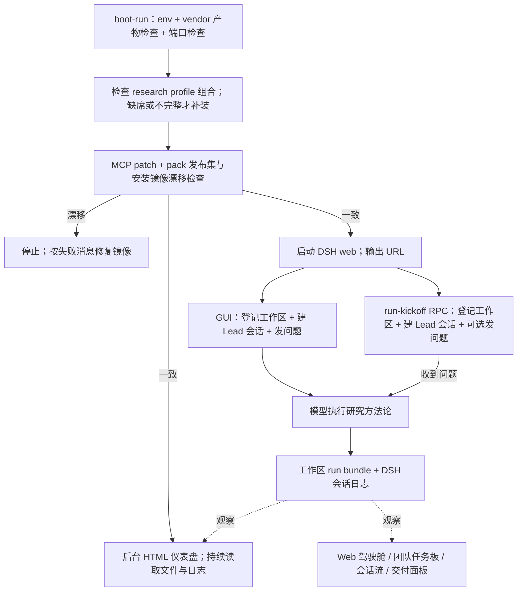

# 项目地图：运行、调试、交互与测试

> 类型：reference。初次接手、追踪一次运行、定位故障或选择验证层时查本页。
> 操作命令和执行次序由 [开发环](guides/60-dev-loop.md) 与 [Run 指南](guides/61-run-playbook.md) 拥有；
> 改仓库仍按根 [AGENTS.md](../AGENTS.md) 的入口链工作。

## 先建立模型

本项目交付一个 DSH 插件包，自身没有独立研究进程。DSH 提供会话、工具、模型调用与团队机制；
插件提供角色配置、方法论技能和研究驾驶舱；研究工作区承载问题、证据和报告。

| 面 | 负责什么 | 查哪里 |
|---|---|---|
| 产品包 | bundle、preset、产品 runtime skills、驾驶舱 client、部署 bin、发布种子、运行形态合同 | [pack README](../packages/deep-research-pack/README.md)、[插件作者指南](guides/62-plugin-authoring.md)、[运行形态合同](guides/65-run-forms.md) |
| 启动与开发驱动 | vendor 构建、环境隔离、生成物同步、安装组合、web 启动、会话驱动 | [开发环](guides/60-dev-loop.md)、[boot-run](../dev/boot-run.sh) |
| 研究运行数据 | 角色会话 cwd、共享手册、节点契约、模板、每次研究 bundle | [研究手册](../research-workspace/AGENTS.md)、[NODES](../research-workspace/NODES.md)、[状态与循环](design/50-agent-loop-and-state.md) |
| 验证与调试 | 静态门禁、确定性回归、挂载/安装/浏览器 smoke、回放、run 审计和观察 | [验收合同](evaluation.md)、[脚本指令](../scripts/AGENTS.md)、[测试指令](../tests/AGENTS.md) |
| 人机交互 | Web 中的问卡、会话流、任务板、驾驶舱与交付面板；独立 HTML 仪表盘提供观察投影 | [驾驶舱设计](design/40-research-cockpit.md)、[Run 指南](guides/61-run-playbook.md) |

根与子树的开发 `AGENTS.md`、开发技能 `.agents/skills/` 指导 Coding Agent 改仓库；
研究工作区的 [AGENTS.md](../research-workspace/AGENTS.md) 与包内角色技能指导研究团队执行研究。
两套技能服务不同任务。团队职责分别是 Lead 立项/综合/交付、Scout 找方向、Analyst 取证、Critic 审查。

## 任务入口矩阵

每个任务只有一个首选入口；Agent Loop 与四类运行状态的合同正本 = [design/50](design/50-agent-loop-and-state.md)，节点 I/O = [NODES](../research-workspace/NODES.md)，命令与前置正本 = [开发环 §2](guides/60-dev-loop.md)。

| 任务 | 首选入口 | 写盘 | 档位 | 事实来源 | 失败后的下一站 |
|---|---|---|---|---|---|
| 启动一次研究 | `node dev/run-driver.mjs up`（内部调 `bash dev/boot-run.sh`；想守前台看日志才直接跑 boot-run） | 是（会话与 bundle） | boot keyless；run 需凭据 | [Run 指南](guides/61-run-playbook.md) | boot 终端报错 → 下文「调试先看哪份事实」 |
| 继续在飞 run | 同上；起来后 lead 会话说「继续 \<slug\>」 | 是 | 同上 | bundle 文件 + [Run 指南](guides/61-run-playbook.md) | bundle 缺件 → NODES 判据定位 |
| 观察在飞 run | boot 自带后台仪表盘 + Web 驾驶舱 | 只读投影 | 浏览器 | [驾驶舱设计](design/40-research-cockpit.md) | 页签坏 → client-load-smoke |
| 回答 HITL | Web GUI 选项卡（产品面）；代理代答 = `dev/hitl-answer.mjs`（开发面） | 是 | 浏览器；代答需真挂起在场 | [Run 指南](guides/61-run-playbook.md) | 卡未弹 → watch-run 看挂起谓词 |
| 查看 run 状态与交付 | `research-workspace/drt_<slug>/` 文件事实（仪表盘只是投影） | 只读 | keyless | [NODES](../research-workspace/NODES.md) | 交付不明 → node-gate 门②③ |
| 验证挂载（插件真挂载） | `source dev/env.sh && DSH_SMOKE_REAL=1 node scripts/smoke/preset-smoke.mjs` | 否 | keyless 真挂载 | [开发环 §2](guides/60-dev-loop.md) | 红 → preset 源 + render-overlay 后复跑 |
| 验证安装 | `source dev/env.sh && node scripts/smoke/release-smoke.mjs` | 是（测试 profile） | keyless（`--install-only` 跳凭据） | [开发环 §2](guides/60-dev-loop.md) | 红 → pack 发布集对账 |
| 查漂移（镜像一致性） | boot-run 漂移门（启动即查，不静默用旧镜像） | 否 | keyless | boot-run 输出 | 红 → 按失败消息重装镜像 |
| 定位故障 | 下文「调试先看哪份事实」表 | 只读 | keyless | 现象 → 事实源映射 | 事实源看完仍不明 → watch-run / node-gate |

## 一次运行怎么串起来

从仓根运行 `node dev/run-driver.mjs up`（内部调 `bash dev/boot-run.sh`），避免相对路径观察工具扫描错位。研究 run 通道默认是 3083；
以当次启动横幅的 URL 为准，端口和生命周期说明在 [Run 指南](guides/61-run-playbook.md)。

[boot-run](../dev/boot-run.sh) 负责环境和安装组合；组合在位只会跳过安装，内容漂移会停止，
不会自动刷新旧镜像。它在 web 启动前拉起仪表盘，仪表盘与 web 随脚本退出停止。

GUI 与 [run-kickoff](../dev/run-kickoff.mjs) 是两个可选的建会话入口。
run-kickoff 默认用研究工作区的 workspaceId 建 Lead 会话；没有 prompt 时只创建会话。
中途修订走 steer，初始 kickoff 的 queue 模式说明在 [Run 指南](guides/61-run-playbook.md)。

模型执行的链是 [lead preset](../packages/deep-research-pack/presets/lead.patch.yml)
→ [research-brief](../packages/deep-research-pack/presets/lead/skills/research-brief/SKILL.md) 立项/HITL1
→ [team-assembly](../packages/deep-research-pack/presets/lead/skills/team-assembly/SKILL.md) 按研究类型派工
→ 侦察/取证 → [synthesis](../packages/deep-research-pack/presets/lead/skills/synthesis/SKILL.md)
→ critic 审查 → HITL2 → 拍板记账、版本记账、present 与目标完成。
节点输入输出和补研究回边以 [NODES](../research-workspace/NODES.md) 为准。

完整研究主要走 Agent Teams；快速事实查证使用单点 worker 与轻量核查。
队友继承父会话组合，派发时须指路读取其方法论文件，不能假设 spawn 会自动切换为对应独立角色 preset。
具体派发规则由 [team-assembly](../packages/deep-research-pack/presets/lead/skills/team-assembly/SKILL.md) 拥有。

## 修改源文件后，哪些副本会受影响

| 正本 → 派生物 | 用于什么 | 同步与检查 |
|---|---|---|
| pack 角色/bundle 配置 → 开发 overlay | L1 源码域冒烟；不是正式 run 的安装源 | [render-overlay](../dev/render-overlay.mjs)；L0 `overlay-fresh` |
| 研究工作区手册、NODES、判型库、模板 → pack 工作区种子 | 对外部署铺工作区；run bundle 不进入种子 | [sync-pack-workspace](../dev/sync-pack-workspace.mjs)；L0 `pack-workspace-fresh` |
| pack 发布集 → research profile 的安装副本 | 正式研究 run 加载的包 | [boot-run](../dev/boot-run.sh) 组合检查与漂移门；修复次序见 [插件作者指南](guides/62-plugin-authoring.md) |
| pack client 源码 → 浏览器构建产物 | Web 驾驶舱 | 构建与浏览器验收次序见 [开发环](guides/60-dev-loop.md) |

修改源、生成派生物、更新安装副本、让运行进程重新加载，是不同动作。
boot 的镜像一致性检查只证明发布集与安装副本一致；overlay 与工作区种子的同步另由 L0 检查。

## 测试怎么选

L0–L4 是验收的五个面，不是由测试名称推导的传统测试金字塔；参与阶梯用 S0–S3 前缀分离（[guides/62](guides/62-plugin-authoring.md)，D27），不与评估面互扰。
本仓已经有确定性行为测试与多种集成证据；端到端位于最外层。命令、前置与必跑面查
[开发环 §2](guides/60-dev-loop.md)，判据查 [evaluation](evaluation.md)。

| 证据 | 入口 | 凭据与外部调用 | 能证明什么 |
|---|---|---|---|
| L0 门禁 | `pnpm verify`；[verify](../scripts/verify/verify.mjs) | 无模型；本地 git 与生成器检查子进程 | 结构、链接、预算、同步等机械不变量 |
| 门禁自测 | [gates-smoke](../scripts/smoke/gates-smoke.mjs) | 无模型；git/node 子进程 | 门禁逻辑回归：注入违规经真实 verify 入口点名报红 + 零注入对照组 |
| 确定性回归 | `pnpm test`；`tests/**/*.test.mjs` | 无模型/浏览器/网络/子进程；导入执行路径另核查，见下方限制 | 纯函数行为、解析、状态折算、渲染输出、审计判据与配置契约 |
| 类型检查 | `pnpm typecheck`；pack 的 `tsconfig.*.json` | 需要 vendor 构建产物；不调模型 | pack 双半 TypeScript 类型面（`src/client` + `src/lib` + host 壳） |
| L1 真实挂载 | [preset-smoke](../scripts/smoke/preset-smoke.mjs) | 无模型；`DSH_SMOKE_REAL=1` 才起真 DSH，本地 RPC 与子进程 | roster、逐角色创建会话、skills 可见性/隔离；默认档只预检 |
| L2 安装 | [release-smoke](../scripts/smoke/release-smoke.mjs) | 无模型调用；npm 安装可能访问网络；`--install-only` 安装检查跳过凭据；默认 preflight 检查凭据在场 | pack → 重建测试 profile → 安装 → scaffold/preflight → 安装域挂载 |
| L2 冷启动 | [cold-start-smoke](../scripts/smoke/cold-start-smoke.mjs) | 无模型调用；团队层需 registry/缓存；MCP 关闭 | 独立 home/profile/端口/state → tarball 安装 → 浏览器面 GREEN |
| 浏览器加载 | [client-load-smoke](../scripts/smoke/client-load-smoke.mjs) | 无模型；真实 web、浏览器、本地通信 | client 装配、页签、渐进面与文件事实对账 |
| 升级端到端 | [e2e-021rc2](../scripts/smoke/e2e-021rc2.mjs) | 无模型调用；真实例或自 boot + 浏览器；须先 source | 角色 order 成组（内置 preset 撞车回归锁）、研究状态/配置页签真数据、本插件面零故障 |
| 确定性回放 | [snapshot-replay-smoke](../scripts/smoke/snapshot-replay-smoke.mjs) | 无真模型；全角色真实 DSH/RPC/解压子进程；仅声明渲染期望的场景额外浏览器渲染 | 场景声明驱动的全角色回放完成标记；persona、全部 request/header 与三处 user/message 注入逐条一致；声明的渲染金标准 |
| 真模型档 | [smoke-contract](../tests/contracts/smoke-contract.test.mjs) 登记的 REAL_MODEL 闭集（成员以测试为准） | 需要模型凭据；调用模型，部分调用 web 工具 | 角色响应/工具调用、团队机制、导航软断言、纪律行为标记断言、真实 HITL UI 迁移、交互探针端到端；不能替代完整研究质量验收。`dev/record-role-fixture` 是独立录制工具，不属于该闭集；完整研究 run 属 L4。 |
| 浏览器交互探针 | [cdp-probe](../scripts/probe/cdp-probe.mjs) | 连接已起 GUI；`--ask` 会发送消息并可能触发模型/工具调用 | 指定场景的显示、点击、会话回复；是否调用模型取决于模式与会话 |
| 偏好库可发现性 | [method-library-probe](../scripts/probe/method-library-probe.mjs) | 真模型档；cwd = 临时研究工作区 | 偏好库文件名/位置、条目数、点名条目缺席时如实说（BUG-042 修复判据的机器化证明） |
| run 文件审计 | [node-gate](../scripts/run-gates/node-gate.mjs)、[schema-scan](../scripts/run-gates/schema-scan.mjs)、[evidence-audit](../scripts/run-gates/evidence-audit.mjs)、[path-hygiene](../scripts/run-gates/path-hygiene.mjs)、[secret-scan](../scripts/run-gates/secret-scan.mjs) | 无主动外网请求；压缩日志读取可能用 zstd 子进程 | 节点在场、部分交接判据、URL/摘录/引用链、本机路径、交付物高置信凭据；默认只读，`--write` 才写审计/门报告 |
| 交付验收 | [run-accept](../scripts/run-ops/run-accept.mjs) | 无模型；须先 source；会跑 node-gate/evidence-audit/path-hygiene/secret-scan | 门 A + 审计（CRITICAL=0）+ 未来日期 + 本机路径 + 高置信凭据；预检红不写，绿写 delivered.json + manifest.json + acceptance.md（present 归一化为相对标签），`--archive` 才归档；`--repair` 修历史回执 |
| 完整 L4 | 真实问题的完整研究 run | 模型与真实信息检索、真人 HITL | 报告质量、可追溯结论与整体研究体验 |

回放夹具不能证明模型服从变化后的方法论；真挂载也不能证明研究质量。
失败先定位到对应层，再扩大验证范围，比让每个变化都跑完整研究更有用。

### 测试词汇对照（传统金字塔词汇 → 本仓形态）

不用 unit / integration / e2e 作组织轴：同一标签下纯核与真 IO 的失败含义不同，**标签回答不了"要什么前置"**——本仓用三轴回答（档位 = 凭什么跑 / 验收面 = 证明了什么 / 命名即层 = 住哪怎么选；正本 = [evaluation](evaluation.md)、[scripts/AGENTS](../scripts/AGENTS.md)、[tests/AGENTS](../tests/AGENTS.md)）。带金字塔词汇来的人按此表对号：

| 传统词汇 | 本仓形态 | 住哪 | 凭据 |
|---|---|---|---|
| 单元（纯函数） | run-state / hitl-fold / activity-fold / tool-card / bundle-bind 等谓词与折算断言（消费 [scripts/lib](../scripts/README.md) 纯函数） | `tests/<domain>/*.test.mjs` | keyless |
| 契约（结构断言） | layering / smoke-contract / evaluation-contract / presets / export-shape / 各门用例 / navigability-contract | `tests/` + [fixtures](../tests/fixtures/README.md) | keyless |
| 集成（真子系统） | preset-smoke（L1）/ release-smoke（L2）/ snapshot-replay / client-load | `scripts/` 冒烟族 | keyless（子进程/浏览器，无模型） |
| 端到端（真模型） | l4-lite / team-preflight / entry-chain-probe / discipline-probe / client-hitl；完整 run = L4 全量 | `scripts/` 真模型档 | 需凭据 |
| 生产审计 | node-gate / schema-scan / evidence-audit（对真实 run bundle） | `scripts/` run 门 | keyless |

### 新检查落家序（加一个检查时按序找家，单一入口）

1. **`tests/<domain>/*.test.mjs` 契约测试**——断言对象是仓内自控文件、keyless 秒级可判真假。义务：同 diff 在 [evaluation](evaluation.md) 对应面登记；新契约测试带反证（[tests/AGENTS](../tests/AGENTS.md)）；
2. **一次性检查**——不复现的核对：跑完即弃（运行区临时脚本），证据（命令 + 输出）进条目实施记录；**复现第二次即升格契约测试**，不滞留临时态；
3. **`*-smoke` 分级冒烟**——需要真子系统（挂载/安装/浏览器/回放）但无模型。义务：后缀申报档位（[scripts/AGENTS](../scripts/AGENTS.md)）；
4. **真模型档脚本**——需要凭据与模型调用。义务：closed set 登记（`smoke-contract` 契约测试对账）；
5. **verify 门禁**——断言跨条目恒真的仓结构不变量。义务：走 [writing-a-gate](../.agents/skills/writing-a-gate/SKILL.md) 全流程（先想红 + gates 数组与 evaluation 台账两处同步）；
6. **run 门（`*-gate` / `*-audit` / `*-scan`）**——断言真实 run bundle 的文件事实，随 run 消费；
7. **`tests/fixtures/` 支撑样本**——taxonomy 建行，consumer 必须真实（[taxonomy](../tests/fixtures/README.md) + 契约测试零孤儿断言）。

新测试资产的**形态**（新后缀 / 新目录）先入词汇表再落文件——词汇表 = [scripts/AGENTS 命名即层](../scripts/AGENTS.md) 与 [tests/AGENTS 放置规则](../tests/AGENTS.md)。

选层的成本原则：穷举矩阵不是目标——**能咬中本次回归的红灯才是**；升档前先问"这个红灯真的会咬中本次改动吗"。

## 脚本、夹具和结果分别放哪里

| 职责 | 查哪些入口 | 结果/支撑资产 |
|---|---|---|
| 门禁、挂载、安装、浏览器、回放与模型检查 | 上表具名入口 | `tests/` 与 [tests/fixtures taxonomy](../tests/fixtures/README.md) 提供确定性消费路径 |
| 研究观察与运维 | [watch-run](../scripts/run-ops/watch-run.mjs)、[run-dashboard](../scripts/run-ops/run-dashboard.mjs)、[plan-card-stats](../scripts/run-ops/plan-card-stats.mjs)、[provider-error-stats](../scripts/run-ops/provider-error-stats.mjs)、[run-kickoff](../dev/run-kickoff.mjs)、[hitl-answer](../dev/hitl-answer.mjs) | `runtime/smoke-workspace/` 放日志与 HTML；会话日志在开发 home；bundle 在研究工作区 |
| 分发生成 | [export-dist](../scripts/dist/export-dist.mjs) | `_dist/` 生成包与安装手册；安装可用性由 L2 证明 |
| 环境与生成物 | [env](../dev/env.sh)、[vendor-build](../dev/vendor-build.sh)、上方同步生成器 | vendor 构建产物、overlay、发布种子 |
| 支撑模块 | `scripts/lib/`、pack `src/lib/` | 消费方直接调用接口；测试覆盖纯解析/折算/判据路径 |

后缀申报检查种类，不能单凭 `smoke`/`probe` 判断是否需要 key。
`tests/**/*.test.mjs`（递归 glob）是默认回归的选中范围；`fixtures/` 与 `_tmp/` 除外；fixture 和 lib 不自动成为测试成员。
夹具包括人工构造样本与经整理、人审冻结的录制回放语料；未经整理的真实运行日志保留在运行区。
回放资产由独立 smoke 消费，不能把“pnpm test 绿”理解为“所有回放/浏览器场景已跑”。

## 调试先看哪份事实

| 现象 | 先看 | 定位下一步 |
|---|---|---|
| 无法启动/镜像漂移 | 本次 [boot-run](../dev/boot-run.sh) 终端报错；进入 web 启动后再看 `runtime/smoke-workspace/web.log` | 环境/构建/组合/镜像检查；修复入口见 [Run 指南](guides/61-run-playbook.md) |
| 页面能开但页签或交互坏 | 浏览器加载/console 与 [client-load-smoke](../scripts/smoke/client-load-smoke.mjs)；随手抓现场 = [scene-capture](../scripts/run-ops/scene-capture.mjs) | [驾驶舱](design/40-research-cockpit.md) 装配与数据通道；HITL 行为另用真模型证据 |
| 想复看**历史会话**当时/现在的页面 | [session-replay](../scripts/run-ops/session-replay.mjs) `<session-id\|标题子串>`（keyless：起通道 → 登记该会话 cwd 工作区 → 按 id 打开 → 抓场景包）；日志侧先看 [session-events](../scripts/run-ops/session-events.mjs) | 场景包读回 = [scene-capture](../scripts/run-ops/scene-capture.mjs) `--show <name>`；边界：现在的客户端代码 + 当年的数据，不是像素级复现 |
| 研究卡住、工具报错、present 不明 | 先用 [session-events](../scripts/run-ops/session-events.mjs) 看该会话的事件尾部；原始日志仍在 `runtime/harness-home/sessions/<工作区组>/<会话>/` | [watch-run](../scripts/run-ops/watch-run.mjs) 看状态；[node-gate](../scripts/run-gates/node-gate.mjs) 查交付声明 |
| HITL 卡没弹出来 / 挂起不明 | [watch-run](../scripts/run-ops/watch-run.mjs) 的挂起谓词（只认 lead 会话的 pending）+ [hitl-answer](../dev/hitl-answer.mjs) 的盘侧自拒信息（未匹配/歧义/非挂起均拒绝作答并说理由） | 挂起与代答语义 = [Run 指南 §3](guides/61-run-playbook.md)；「卡永久 pending」边界 = [Run 指南 §5](guides/61-run-playbook.md) |
| 模型回合被流错误终结 / 重试风暴 | [stream-diagnostics](../scripts/run-ops/stream-diagnostics.mjs) `--session <id>` 或 `--recent N` | 模型尝试时间线/失败密度/provider 与重试策略实名；处置 = [Run 指南 §0.1](guides/61-run-playbook.md) |
| 研究内容/交接缺件 | 该 bundle 的问题、证据、发现、审查与最终报告 | [NODES](../research-workspace/NODES.md) + run 机械审计；恢复查 [Run 指南](guides/61-run-playbook.md) |
| 不知道改什么、怎么验 | 根 [AGENTS.md](../AGENTS.md) 入口链与本轮请求授权 | 对应 RFC 与 [开发环](guides/60-dev-loop.md) 任务型路由 |

`web.log` 是宿主启动输出；DSH 会话日志记录模型/工具/HITL/present 事件；bundle 的 journal 是角色纪要。
三者用途不同。日志文件版本由实际宿主决定，按会话定位，不凭固定版本文件名猜测。

`final.md` 是 run 根的当前报告，`final/vN` 是交付副本，`final/readable-vN` 是同版读者版（新 run）；文件出现、watcher 停下、仪表盘显示交付，
都需要结合拍板行、版本记账、present、门C 和审计来判断。完整判据查 [NODES](../research-workspace/NODES.md)。

## 已知限制与延后工作

- `scripts/` 同时包含检查、运维、投影和导出，物理布局依靠[职责索引](../scripts/README.md)解释；`dev/` 同理见 [dev 入口说明](../dev/README.md)；职责分组与目录取舍见
  [目录与入口治理 Note](../notes/implemented/2026-10-05-project-navigability.md)。
- `layering` 主要扫描顶层测试文本；默认 run-state 回归的日志读取路径使用原生 Node 解码，覆盖直读、连续帧及损坏日志，零外部解压子进程。
  真实部署与浏览器脚本仍属于分级 smoke，不进入默认回归。
- L2 无模型调用；`release-smoke` 使用显式 `--install-only` 跳过模型就绪检查，独立默认 preflight 仍检查凭据在场。
- HTML 仪表盘使用 canonical 日志选择器、共享 HITL 折算和共享步骤折算；它仍是 fail-soft 观察投影，不是交付绿灯——日志回退（BUG-007 形态）下可能显示旧态，回退守卫不进仪表盘（非判据消费方）；判据消费方 = watch-run（内建回退检测）与机械门（缺证据即红，失败方向安全）。
